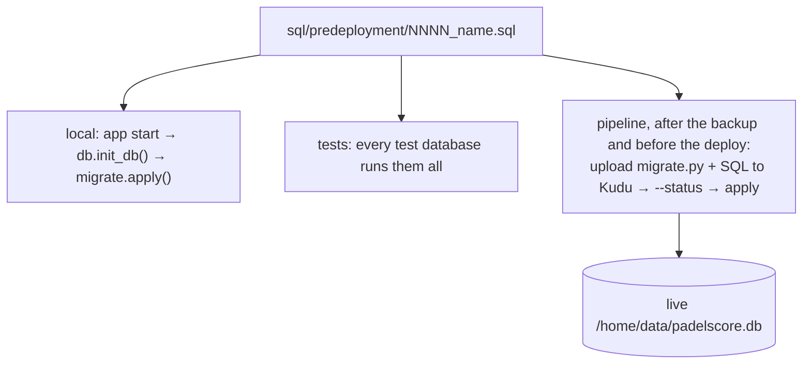

# Database changes (pre-deployment SQL)



- **The starting point:** `db.SCHEMA` is the database as it was before pre-deployment
  SQL. Older changes are the Python functions in `db.py` (`add_rule_types`,
  `add_organizations`...).
- **New changes:** every change after that is a file in `sql/predeployment/`:
  `0001_users.sql`, `0002_medals.sql`, and so on. **Never edit a file that has already
  run.** Add the next number instead.
- **How they run:** `app/migrate.py` runs each pending file once, in order, inside a
  transaction (`BEGIN … COMMIT`), and records it in `schema_migrations`. If a file
  fails, it is rolled back and the run stops, so the deploy doesn't happen.

## Writing one

1. Name it with the next 4-digit number and a short name.
2. Start with a comment saying what it changes and why.
3. Keep it **additive**: the old app version keeps running between the migration and
   the deploy. Add tables, columns, indexes and rows. Don't drop or rename something the
   running version reads. Do that two releases later.
4. Don't use `IF NOT EXISTS` on columns (SQLite has no such thing). Each file runs once,
   so you don't need it.
5. Data moves go in plain SQL (`INSERT … SELECT`). For random secrets, use
   `lower(hex(randomblob(32)))`.

## Checking it

```
cp padelscore.db <scratchpad>/migtest.db
PADELSCORE_DB=<scratchpad>/migtest.db .venv/Scripts/python.exe -m app.migrate --status
PADELSCORE_DB=<scratchpad>/migtest.db .venv/Scripts/python.exe -m app.migrate     # twice: the second is a no-op
sqlite3 / python: PRAGMA integrity_check; PRAGMA foreign_key_check; row counts unchanged
```

- **Tests:** the old-database tests build databases from `db.SCHEMA` (`BEFORE_ACCOUNTS`
  in the tests) and then run `init_db()`. Add a test that reads the new data.
- **Live, read-only:** `python3 -m app.migrate --status` lists what's pending (see the
  `padelscore-live-admin` skill). After the deploy, `/health` lists the applied files.
