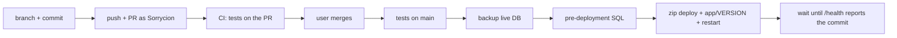

# Deploying PadelScore

Live site: https://padelscore-sorrycion.azurewebsites.net (Azure App Service
`padelscore-sorrycion`, resource group `padelscore-rg`). Only use the personal
subscription `af2fe534-02d1-4920-8bea-24efdcac3083`. Never touch the work subscriptions
("Dev-Test Subscription", "Avea Production"), and never change the default az account.



## Normal path: pull request → automatic deploy

1. **Tests:** all must pass (`.venv/Scripts/python.exe -m pytest -q`, after
   `pip install -r requirements-dev.txt`).
2. **Branch and commit.** Branch from an up-to-date `main`. Commit messages end with
   `Co-Authored-By: Claude Opus 5.5 <noreply@anthropic.com>`.
3. **Push.** Git authenticates as **Sorrycion** through a repo-local credential helper
   (`gh auth token --user Sorrycion`), whichever gh account is active.
4. **Open the PR:**
   `GH_TOKEN=$(gh auth token --user Sorrycion) gh pr create -R Sorrycion/PadelScore --base main --head <branch> --title ... --body ...`.
   The body ends with `🤖 Generated with [Claude Code](https://claude.com/claude-code)`.
   With stacked PRs, write "merge #N first".
5. **The user merges.** "PR merged" means: watch the run and check the live site. The
   run (`.github/workflows/deploy.yml`):
   - tests again;
   - backs up the database to `/home/data/padelscore-backup-<date>-gh.db`;
   - runs the pending `sql/predeployment` files on the live database (`app/migrate.py`
     uploaded to a temporary Kudu folder: `--status`, then apply);
   - zip deploys, with `app/VERSION` holding the commit, and restarts;
   - waits until `/health` reports that commit (the old instance answers for a while).
6. **Watch it:**
   ```bash
   export GH_TOKEN=$(gh auth token --user Sorrycion)
   gh run list -R Sorrycion/PadelScore -L 3
   gh run watch <id> -R Sorrycion/PadelScore --exit-status
   gh run view <id> -R Sorrycion/PadelScore --log | grep -E "PENDING|applying|up to date|live version"
   curl -s https://padelscore-sorrycion.azurewebsites.net/health
   ```
   Then check the change itself on the live site. Pages need an organization: enter one
   with `curl -c cj -b cj -X POST -d "name=Nene&next=/" .../enter`.

Pushing `.github/workflows/*` needs the `workflow` scope on Sorrycion's gh token. It
was added on 2026-10-28. If a push is refused for that, the user runs
`gh auth switch -h github.com -u Sorrycion`, then
`gh auth refresh -h github.com -s workflow` (approving in the browser as Sorrycion),
then switches back to `julio-curiel-kipu-13`. `gh auth refresh` has no `-u` flag.

Azure login in the pipeline: OIDC as the service principal `padelscore-github`
(Website Contributor on the web app). The federated subject is
`repo:Sorrycion@28118944/PadelScore@1432403444:environment:production`, the id-based
format. Repository secrets: `AZURE_CLIENT_ID`, `AZURE_TENANT_ID`,
`AZURE_SUBSCRIPTION_ID`.

## Fallback: manual deploy through Kudu

Only when Actions can't be used, and only if the user asks. The az default account is
the work one, so `az webapp deploy` and `az rest` give 403. Use a bearer token instead:

```bash
T=$(az account get-access-token --subscription af2fe534-02d1-4920-8bea-24efdcac3083 --resource https://management.azure.com/ --query accessToken -o tsv)
K=https://padelscore-sorrycion.scm.azurewebsites.net
# 1. Back up (one command per call, no shell: no && or pipes), then check with ls -l /home/data
curl -s -X POST -H "Authorization: Bearer $T" -H "Content-Type: application/json" "$K/api/command" \
  -d '{"command":"cp -p /home/data/padelscore.db /home/data/padelscore-backup-<date><letter>.db","dir":"/home"}'
# 2. Pre-deployment SQL: see padelscore-live-admin ("Run the pending SQL by hand")
# 3. Deploy, with the version stamp
git archive --format=zip -o deploy.zip HEAD && git rev-parse HEAD > app/VERSION && zip -q deploy.zip app/VERSION
curl -s -w "%{http_code}" -X POST -H "Authorization: Bearer $T" --data-binary @deploy.zip "$K/api/zipdeploy"
# 4. Restart, or the old version keeps running; then poll /health for the commit
az webapp restart --subscription af2fe534-02d1-4920-8bea-24efdcac3083 -g padelscore-rg -n padelscore-sorrycion -o none
```

Delete the local `app/VERSION` afterwards (it's git-ignored).

## Never

- Commit `padelscore.db`, `.venv` or secrets.
- Put real credentials in tests, commits or command output (use `-o none`).
- Change Azure app settings, secrets or identities yourself: the auto-mode classifier
  blocks it. Give the user the command instead (Cloud Shell avoids their work-default az).
