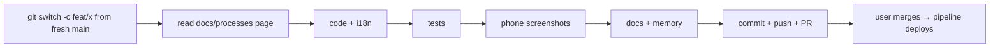

# Building a PadelScore change

1. **Branch.** Run `git switch main && git pull`, then `git switch -c feat/<name>` (or
   `fix/`, `ui/` or `docs/`). If the user asks for several parts, stack the branches and
   say in each PR which ones to merge first.
2. **Read the area's page** in `docs/processes/`. `ARCHITECTURE.md` maps the modules.
3. **Code where it belongs:**
   - **Routes and queries:** `app/main.py`. Every query must stay inside the current
     organization: use `org_id()`, `get_or_404`, `set_rows`, `all_players` and so on.
   - **Pure logic:**
     - `scoring.py`, `rounds.py`, `stats.py`, `medals.py`: no database;
     - `charts.py` (SVG);
     - `users.py` and `orgs.py`: standard library only, because Kudu runs them.
   - **Templates:** `app/templates/`. Layout goes in `app/static/style.css`, using the
     color variables so dark mode works.
   - **Texts:** `app/i18n.py`, in both `es` and `en`. Templates call `_("key")`. Keys
     built at runtime (e.g. `_(ROLE_KEYS[x])`) need a `templates.env.globals` lookup,
     because the test only sees literal keys.
   - **Schema or seed data:** follow the `padelscore-db-change` skill.
4. **Patch safely.** Write a Python patch script to the scratchpad. Use a
   `rep(file, old, new)` helper that asserts `old` occurs exactly once, then run it with
   `python -X utf8 script.py </dev/null`. Git Bash heredocs break on quotes and emoji.
   Don't name a helper after an existing route function (e.g. `rename_player`).
5. **Test.** Add tests to `tests/test_app.py`, using the fixtures:
   - `client`: organization "Club", logged in as its admin `admin` / `secreto`;
   - `league`: players 1-8 and tournament 1 with matchday 1;
   - `locked`: the same, not logged in;
   - `with_players`: player password `jugamos` and two sets.

   Run all of them: `pytest -q`. Fake credentials only.
6. **Look at it on a phone.** Follow `padelscore-screenshot`, at 500 px, light and dark.
7. **Document it: required for every PR** (the user's rule). In the same branch:
   - **Process docs:** the `docs/processes/` page of each area touched, with its Mermaid
     diagram redrawn if the flow, the data or the screens changed. A new area gets a
     new page, linked from `docs/processes/README.md`.
   - **Architecture:** `docs/processes/ARCHITECTURE.md` if a module, route group,
     table or the navigation changed. `README.md` if setup or the project layout changed.
   - **Skills:** `.claude/skills/` updated if a procedure changed, or a new skill if
     it's a task that will repeat. New skills go in the table in `CLAUDE.md`.
   - **Memory:** the area's memory file (live state, decisions and why, open items)
     and its line in `MEMORY.md`.
   - **PR body:** a "Docs and memory" section that lists the above.

   Mermaid diagrams: `flowchart` for steps and screens, `sequenceDiagram` for
   requests, `erDiagram` for tables. Keep labels short; GitHub draws them.
   `tests/test_app.py::test_knowledge_base_is_linked` checks that every process page
   is linked from the index and every skill is in `CLAUDE.md`.
8. **Commit, push and open the PR** as described in `padelscore-deploy`. Follow
   `.github/pull_request_template.md`: what changed, database changes, test count, and
   the **Docs and memory** section with what was updated.
9. **After the merge,** watch the run and check the live site (see `padelscore-deploy`).
