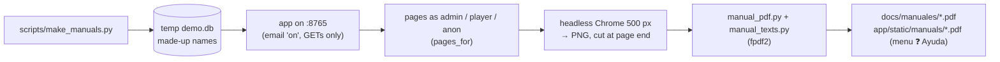

# User manuals (📘 Manual del administrador / del jugador)

1. **Run:** `.venv/Scripts/python.exe -X utf8 scripts/make_manuals.py` (Chrome needed; port
   8765 free). It prints the work folder with the screenshots.
2. **Only texts changed?** Reuse the screenshots:
   `MANUAL_WORK=<that folder> .venv/Scripts/python.exe -X utf8 scripts/make_manuals.py`.
3. **Texts** are in `scripts/manual_texts.py` (Spanish; no emoji: PDF core fonts are
   Latin-1). Blocks: `p`, `h`, `steps`, `bullets`, `table`, `tip`, `warn`, `shots`.
4. **Screenshots:** `pages_for()` in `make_manuals.py` lists each page (who, URL,
   options `menu`, `open=
`, `banner`, `games`). A `shots` block cuts a page
   to pixel rows `(name, top, bottom, caption)`: when a screen changes, check the cuts
   still frame the right part (render the PDF pages, e.g. with PyMuPDF, and look).
5. **Never real data:** the demo league is seeded by `seed()` with made-up names.
6. **Look at every page** before committing; commit both PDF copies.
7. **Port 8765 must be free:** a server left from `padelscore-screenshot` answers with the
   wrong database and the pages come out as ~488 px stubs (crops then fail).

## When (the user's rule): every commit that changes what users see

A project hook enforces it: `.claude/settings.json` runs `scripts/check_manuals.py`
before every `git commit` Claude makes. If the staged files touch `app/templates/`,
`app/static/` (not the manuals) or `app/i18n.py` and no manual PDF is staged, the
commit is blocked with these steps. When the change doesn't touch any screen the
manuals show (e.g. an email template or an admin-only tweak already described), put
`[manuals: n/a]` in the commit message.
