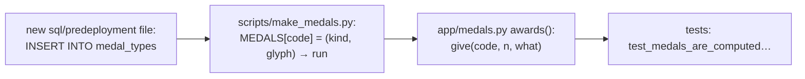

# Adding or changing a medal

Background: `docs/processes/MEDALS.md`.

1. **Catalog row.** In a new `sql/predeployment/NNNN_<name>.sql` (see
   `padelscore-db-change`):
   - to add: `INSERT INTO medal_types (code, kind, sort, name_es, name_en, how_es, how_en)`;
   - to change: `UPDATE`;
   - `kind` is `glory`, `rival` or `shame` (a joke);
   - `sort`: glory goes 1-19, rival 20-29, shame 30 and up.
2. **Image.** Add `"code": (kind, glyph)` to `MEDALS` in `scripts/make_medals.py`, run
   it, and commit the new `app/static/medals/<code>.svg`. The style is shared: ribbon
   and medal, with colors set by the kind.
3. **Rule.** Add it in `medals.awards(sets, pid, tournaments)`:
   - `sets`: the player's played sets, oldest first. Each has `rule_code`, the games, and
     `stats.games(s, pid)` gives the player's (for, against).
   - `tournaments`: `player_tournaments()` rows (`position`, `last_position`, `ended`,
     `matchdays`, and `history` with one row per matchday: `court`, `sets`, `sets_won`,
     `place`, `absent`).
   - `give(code, n=1, what=name)` counts it. Tiered medals go in `TIERS`, and "reach a
     total" medals in `THRESHOLDS`.
   - Podiums need `ended`. Game-based medals only count `GAME_RULES` (Liga, Manual).
4. **Scope.** The same rule runs for a player's whole career (their medals tab and
   `/medals`) and for one tournament (the icons in the ranking tables:
   `tournament_medals()` passes only that tournament's sets and rows). Make sure it
   reads right in both.
5. **Test** it in `tests/test_app.py` next to `test_medals_are_computed_from_sets_and_tournaments`,
   then look at `/medals` and a tournament page on a phone.
6. **Update** the table in `docs/processes/MEDALS.md` and the `padelscore-medals` memory.
