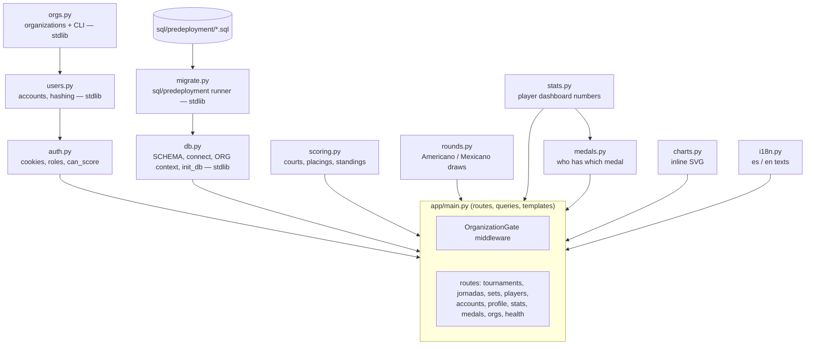
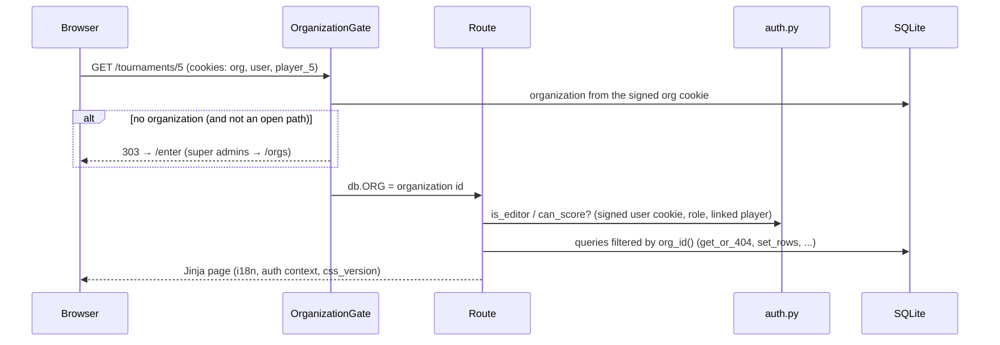
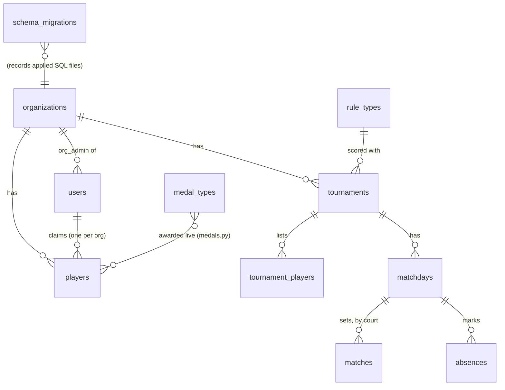

# Architecture

One FastAPI app, rendered on the server with Jinja2. SQLite is the database, in one file:
`padelscore.db` locally, `/home/data/padelscore.db` on Azure. There is no JavaScript
framework: only a small player picker (`app/static/picker.js`).

## Modules

The modules marked *stdlib* use only the standard library, so the pipeline and the Kudu
console can run them on Azure without the app's dependencies.

## A request

- **Open paths** (no organization needed): `/` (the login, or an account's home across
  organizations), `/enter`, `/login`, `/logout`, `/static`, `/lang`, `/rules`, `/orgs`,
  `/me`, `/health`, `/signup` (an account with no tournament), `/join` (a tournament's
  password, from the home page). The standings of an organization are at `/standings`.
- **Calculated, not stored:** standings, statistics and medals are always worked out
  from the sets. Only sets, absences and the lists are stored.
- **Pages that span organizations** run their queries per organization with
  `in_org(org_id, work)`. That's `/` (the home: tournaments and next sets in every
  organization) and `/me`, which lists an account's players everywhere and adds them up
  (`career`).
- **Navigation:** on wide screens the sections are a row of pills under the header. On
  phones (640 px or less) they fold, with the account links and the language, into a
  ☰ menu. It's a hidden checkbox (`#menu-toggle`) and CSS, with no JavaScript.

## Data

## Where things run

| Where | What |
|---|---|
| Laptop | `uvicorn app.main:app --reload` on `padelscore.db`. It migrates on start |
| GitHub Actions | Tests on every PR; on `main`: tests, backup, pre-deployment SQL, deploy, `/health` check ([DEPLOY.md](DEPLOY.md)) |
| Azure App Service F1 | gunicorn + uvicorn worker, one instance (SQLite must not be shared) |
