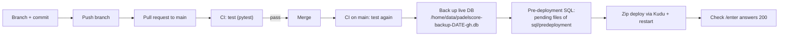

# Deploy

`main` is protected: changes arrive through pull requests. Every push to `main`,
including a merge, deploys to https://padelscore-sorrycion.azurewebsites.net via
`.github/workflows/deploy.yml`.

- **Azure login:** the service principal `padelscore-github` logs in through OpenID
  Connect, with no stored password. Its role is Website Contributor on the web app
  only. GitHub sends the subject
  `repo:Sorrycion@28118944/PadelScore@1432403444:environment:production`, which must
  match the federated credential `github-production-ids`.
- **Repository secrets:** `AZURE_CLIENT_ID`, `AZURE_TENANT_ID`, `AZURE_SUBSCRIPTION_ID`.
- **The live database** is SQLite in `/home/data/padelscore.db`.
- **Pre-deployment SQL:** the pipeline uploads `app/db.py`, `app/migrate.py` and
  `sql/predeployment/*.sql` to a temporary Kudu folder. It runs
  `python3 -m app.migrate --status`, then `python3 -m app.migrate`, against the live
  database, and deletes the folder. If a file fails, the run stops before the deploy,
  and that file's changes are rolled back. The app runs the same thing when it starts,
  so local databases catch up too.
- **Manual deploy** (fallback, when GitHub Actions can't be used): see the skill
  `.claude/skills/padelscore-deploy`.
