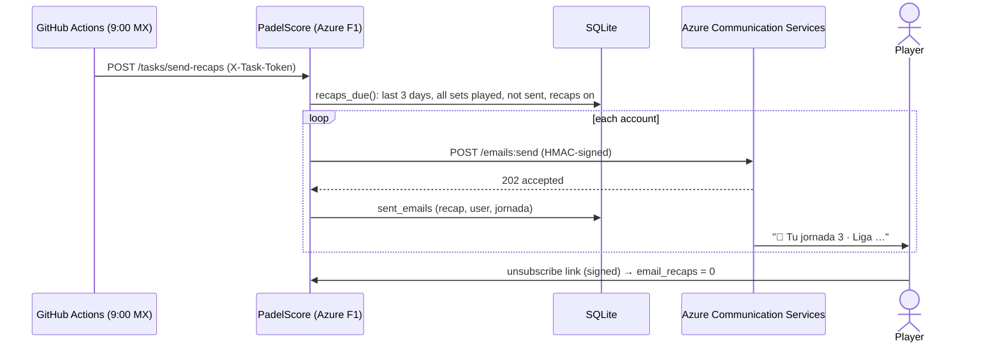
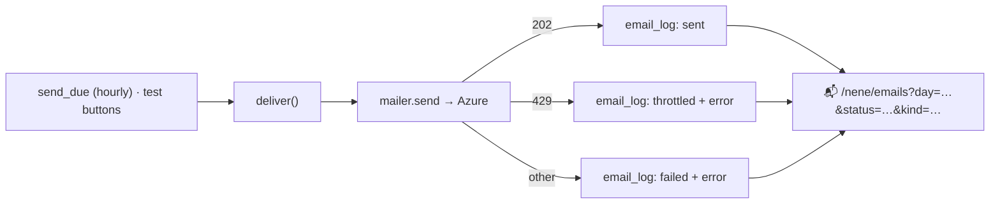
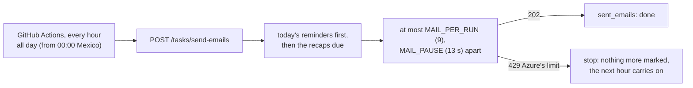

# Email

PadelScore sends email through **Azure Communication Services** (ACS), in the personal
subscription, at about US$0.00025 per email. A league of 20 players costs cents a
year. The code is `app/mailer.py` (the ACS REST API signed with the access key, standard
library only).

## What it sends

- **⏰ The game-day reminder**, the morning of the jornada (the same daily job, first
  `POST /tasks/send-reminders`). It goes to every account with an email and a player
  that has a set of that jornada still to play, once (`sent_emails`, kind
  `reminder`), unless "⏰ Recordarme…" is off on `/me`. It has:
  - the jornada and **court**;
  - the **position and points** before the jornada, and the current streak;
  - the **summary** of the tournament so far (sets won, win rate);
  - **each set:** partner, rivals, the **chance of winning** (a bar: favorites at 60%+,
    even, uphill at 40% or less), and the record against each rival ("contra Omar:
    3-1", or "primera vez");
  - a link to the jornada.

  The chance is `stats.win_probability` (see [STATS.md](STATS.md)). The web shows the
  same numbers: a bar on each **pending set** of a jornada and on its result page,
  and "🎯 Probabilidad de ganarle a X" on ⚔️ Cara a cara.

- **The jornada recap**, the morning after. A GitHub Actions job
  (`.github/workflows/daily-emails.yml`, every hour, all day, from 00:00 Mexico time) calls
  `POST /tasks/send-emails`, which sends the due reminders and then the recaps (see the
  limits below). That emails every account that:
  - played a jornada in the last 3 days (up to yesterday);
  - has an email, and has recaps on (the default);
  - has **all its sets of that jornada played** (otherwise it waits for the next
    morning);
  - wasn't emailed that recap yet (`sent_emails`). Each recap goes once.

  **Only accounts with an email and a player** get it: the task starts from the players
  of the jornada's sets and joins their accounts, so admins without a player never do.

  The email (`email_recap.html`, built by `recap_email` with `email_extras`) has:
  - **the jornada:** place, points and sets won on the court, the position in the
    standings with ▲▼, the next jornada's court;
  - **🏆 Clasificación del torneo:** the whole standings table, with the player's row
    highlighted;
  - **📊 Tu torneo:** sets, wins, win rate, games difference and best streak in that
    tournament;
  - **charts:** points per jornada (bars, today's in dark blue) and the latest 12 sets
    (green / red / gray squares);
  - **🏅 Tus medallas del torneo:** each one with its emoji, and "¡nueva!" on the ones won
    that day;
  - buttons to the public recap ("📲 Mi jornada") and to share it on WhatsApp.

  Email apps ignore stylesheets and most don't show SVG. So it's plain HTML with inline
  styles and tables, the charts are HTML bars and squares, and the medals are their
  emoji (`medals.ICONS`, the same list that draws their images).
- **⏰ next to a player** in a tournament's player list (admins): sends that player now
  the reminder of their next jornada with sets to play (or their latest one). It isn't
  recorded. The unsubscribe link of a reminder only stops reminders (`?kind=reminders`).
- **⏰ Probar recordatorio** on **🔑 Cuentas** (next to 📧 Probar email, on accounts with an
  email and a player): sends that account, right away, the game-day reminder of its
  player's **next jornada with sets to play, whatever its date** (or else its latest
  one), to see it before the day. It isn't recorded, so the real reminder still goes
  that morning. The ⏰ in a tournament's player list does the same within that
  tournament (`next_jornada`, `send_test_reminder`).
- **📧 Probar email** on **🔑 Cuentas** (`/users`, admins), on each account with an email:
  sends that account, right away, the recap of its player's latest jornada in this
  organization, or a plain test message if it has none. It isn't recorded.
- **📧 Probar email** on `/orgs` (super admins) sends a test email to your own address.
- **📧 next to a player** in a tournament's player list (admins; only players whose
  account has an email): emails that player, right away, the recap of their latest
  jornada in the tournament, to try it. It isn't recorded, so the morning email still
  goes.
- **No domain needed:** the setup uses an *Azure-managed domain*, so mail comes from
  `DoNotReply@<code>.azurecomm.net`, with no DNS and nothing to buy. Its quotas are low
  but enough for a league. The first emails may go to spam until players mark them as
  not spam.



- **Opting out:** the checkbox "📧 Recibir por email el resumen de mi jornada" on `/me`,
  or the unsubscribe link in each email (`/unsubscribe/{id}/{token}`, signed with the
  account's secret, so it works without logging in).
- **Language:** Spanish (accounts don't keep a language yet).
- **Without the settings** below, nothing is sent: the task answers
  `{"enabled": false}` and `/orgs` says email is off.

## 📬 The email log (admins)

Every email the app tries to send goes through `main.deliver()`, which calls
`mailer.send()` and writes a row in **`email_log`** (`sql/predeployment/0008_email_log.sql`),
sent or not:

- the time (UTC) and the **league day**;
- the organization, the account and its address;
- the **kind**: recap, reminder, test-recap, test-reminder or test;
- the jornada, the subject;
- the **status**: sent, failed, or throttled (Azure's limit), with Azure's error.

**📬 Emails** (`/<slug>/emails`, admins; linked next to 🔑 Cuentas) shows one day of it:
← → or a date picker, the day's totals per status, filters by status and kind, and a
text filter. An organization admin sees its organization's emails. Rows that failed are
tinted.



`sent_emails` stays as it was: it's what keeps each recap or reminder from going twice.
`email_log` is the history.

## Azure's sending limits, and how the job keeps under them

With the free **Azure-managed domain**, ACS allows **5 emails a minute and 10 an hour
for the whole subscription**. A custom domain allows 30 a minute and 100 an hour, and
more on request. Over the limit, ACS answers **429**. That's what happened on 2026-11-05:
the morning run sent 10 recaps, and the test buttons failed for the rest of that hour.



- **`send_due`** (in `main.py`) sends reminders, then recaps, up to `MAIL_PER_RUN` per run
  (default 9: one left each hour for the admins' test buttons). There are
  `MAIL_PAUSE` seconds between emails (default 13: under 5 a minute). It records each
  one as it goes. On a 429 it stops, and the rest wait for the next hourly run.
- **Capacity:** 24 runs a day × 9 = about 200 emails a day (the user's choice, 2026-11-05:
  it's free, so send from midnight, hour after hour, until all are out). A jornada's
  reminders go out from 00:00, and with 20 players they're all out by about 02:00.
- **"Today" is Mexico's** (`league_today()`, app setting `LEAGUE_UTC_OFFSET`, default -6).
  The server runs on UTC, which is already tomorrow from 18:00 in Mexico. Without it,
  "¡Hoy juegas!" would go out the evening before, and the new jornada's date would
  default to tomorrow.
- **Test buttons:** on a 429 they say "Azure no dejó enviarlo: … 10 emails por hora…"
  (`err_mail_throttled`).
- **With a custom domain** (about US$10/year), raise the app settings, e.g.
  `MAIL_PER_RUN=90` and `MAIL_PAUSE=2`. The sender can then be "PadelScore".
- **App logs:** `mailer.send` prints why Azure refused an email. To keep those lines,
  turn on App Service → App Service logs → Application logging (Filesystem). They go
  to `/home/LogFiles/*_default_docker.log`.

## Setup (once, by the owner)

These change Azure settings and secrets, so the owner runs them, in **Azure Cloud Shell**
(Bash) on the **personal subscription**:

```bash
SUB=af2fe534-02d1-4920-8bea-24efdcac3083
RG=padelscore-rg
az account set --subscription $SUB            # Cloud Shell only; doesn't touch your laptop
az provider register --namespace Microsoft.Communication --wait
az extension add --name communication --upgrade

# 1. Email service + a free Azure-managed sender domain (xxxx.azurecomm.net)
az communication email create --name padelscore-email --resource-group $RG \
  --location global --data-location "United States"
az communication email domain create --domain-name AzureManagedDomain \
  --email-service-name padelscore-email --resource-group $RG \
  --location global --domain-management AzureManaged

# 2. Communication Services resource, linked to that domain
az communication create --name padelscore-acs --resource-group $RG \
  --location global --data-location "United States"
DOMAIN_ID=$(az communication email domain show --domain-name AzureManagedDomain \
  --email-service-name padelscore-email --resource-group $RG --query id -o tsv)
az communication update --name padelscore-acs --resource-group $RG --linked-domains $DOMAIN_ID

# 3. App settings: connection string, sender, and a token for the daily job
SENDER_DOMAIN=$(az communication email domain show --domain-name AzureManagedDomain \
  --email-service-name padelscore-email --resource-group $RG --query mailFromSenderDomain -o tsv)
CONN=$(az communication list-key --name padelscore-acs --resource-group $RG \
  --query primaryConnectionString -o tsv)
TOKEN=$(openssl rand -hex 32)
az webapp config appsettings set --resource-group $RG --name padelscore-sorrycion -o none \
  --settings ACS_CONNECTION_STRING="$CONN" MAIL_SENDER="DoNotReply@$SENDER_DOMAIN" TASKS_TOKEN="$TOKEN"
echo "Sender: DoNotReply@$SENDER_DOMAIN"
echo "Now save this as the GitHub secret TASKS_TOKEN: $TOKEN"
```

Then add the repository secret **TASKS_TOKEN** with that value (GitHub → Settings →
Secrets and variables → Actions, or `gh secret set TASKS_TOKEN -R Sorrycion/PadelScore`).
Check it with **📧 Probar email** on `/orgs`. Your account needs an email on `/me`, and
the first emails may land in spam. Actions → "Daily emails" → **Run workflow** runs the
morning job by hand.

If a CLI command fails (the `communication` extension changes now and then), the
Portal does the same: create "Email Communication Services" → Provision domains → "Add
an Azure subdomain"; create "Communication Services" → Email → Domains → Connect
domain; the connection string is under Keys; the sender is `DoNotReply@<that domain>`.

**Limits:** an Azure-managed domain has low sending quotas (enough for a league). For a
custom sender (`resultados@tudominio.com`), add your own domain and verify its DNS.
