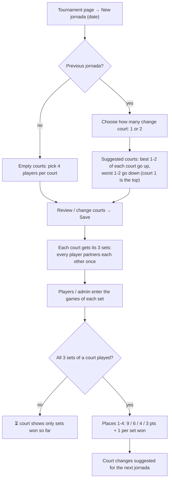
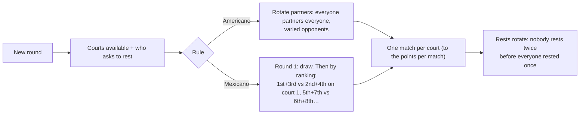

# Jornadas (matchdays and rounds)

A jornada (called "Ronda" in Americano and Mexicano) is one day of a tournament. Its
players are split into courts (canchas) of four. Jornadas are numbered 1, 2, 3… with
no gaps: deleting one renumbers the later ones. Only admins create, change or delete
jornadas.

## Liga de amigos

- **Place order:** sets won, then games difference, then league position before the
  jornada. On jornada 1 a draw settles ties.
- **Changing courts** (`/matchdays/{id}/courts`): a court that keeps the same four
  players keeps its sets. A court with new players gets 3 new sets, and its old sets
  are deleted.
- **Absent player** (🚫 next to the name in the court table): a substitute plays in
  their place, but the absent player scores 0 that day and goes last on the court.
  Tap again to mark them present.
- **Replace** (next to the name in the court table): opens the replace page. The new
  player takes the place in pending sets and in the tournament list. See
  [Tournaments](TOURNAMENTS.md).

## Americano and Mexicano (rounds)

Each player scores the points their pair won in every match.

## Manual individual

A jornada has only a date. There are no courts to assign: the admin, or players logged
in with the tournament's player password, add sets one by one.

## The jornada page

Each court is shown on its own panel, alternating gray and blue so it's easy to tell
the courts apart. A panel holds the court's sets with their games and the court's table
(place, player, games difference, sets won, points). Below the courts are the resting
players (rounds), the court changes (Liga), and the button for the next jornada.

Code: matchday routes are in `app/main.py` (`/matchdays/...`,
`/tournaments/{id}/matchdays/new`). Scoring is in `app/scoring.py`, and round drawing
is in `app/rounds.py`.
