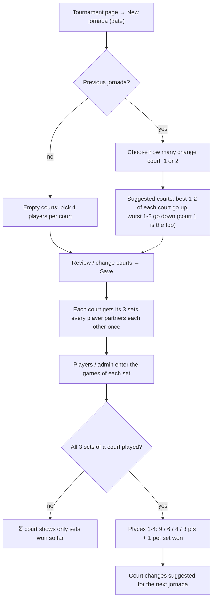
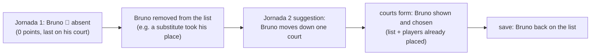
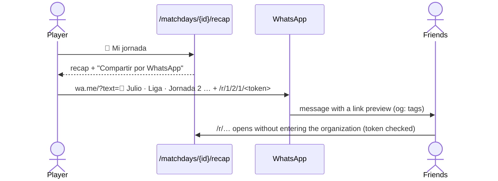
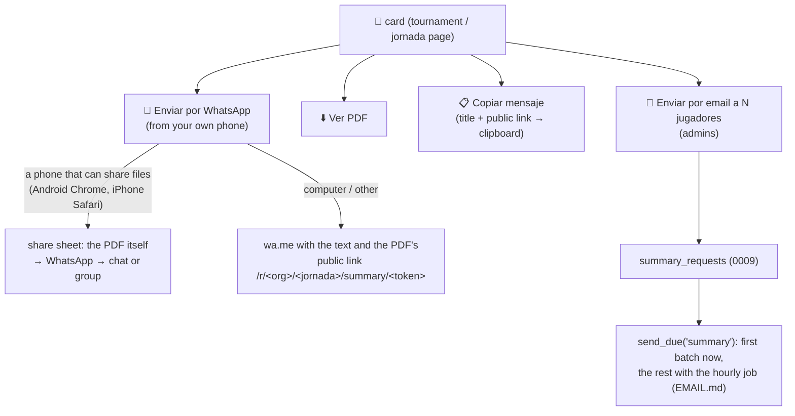
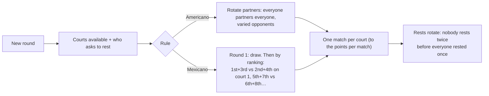

# Jornadas (matchdays and rounds)

A jornada (called "Ronda" in Americano and Mexicano) is one day of a tournament. Its
players are split into courts (canchas) of four. Jornadas are numbered 1, 2, 3… with
no gaps: deleting one renumbers the later ones. Only admins create, change or delete
jornadas.

## Liga de amigos

- **Place order:** sets won, then games difference, then league position before the
  jornada. On jornada 1 a draw settles ties.
- **Changing courts** (`/matchdays/{id}/courts`): a court that keeps the same four
  players keeps its sets. A court with new players gets 3 new sets, and its old sets
  are deleted.
- **Absent player** (🚫 next to the name in the court table): a substitute plays in
  their place, but the absent player scores 0 that day and goes last on the court.
  Tap again to mark them present. **They stay in the tournament:** the next jornada's
  suggested courts include them (as last of their court, they move down), even if
  they were removed from the tournament's list in the meantime.
- **Who can be chosen on a court:** the tournament's list plus anyone the suggestion
  already placed. **Saving a jornada puts all its players on the list** (when the
  tournament keeps one), so the list never misses someone who's playing.

- **Replace** (next to the name in the court table): opens the replace page. The new
  player takes the place in pending sets and in the tournament list. See
  [Tournaments](TOURNAMENTS.md).

## 🎯 Chances on pending sets

**Every pending set, wherever it shows**, has each pair's chance of winning: a bar with
pair A on the left in **blue** and pair B on the right in **red** (for example "58% ·
42%"). That covers the jornada page, Sets (`/matches`), a player's page, the standings
page, the result page, and the next sets on the home page and on `/me`. It comes from
the records of the four players ([STATS.md](STATS.md)). Played sets don't show it.

Code: `chance_of(m)` (a template global) works out each organization's records once per
request and caches them in the request's context. `_chance.html` draws the bar. Lists
that mix organizations (home, `/me`) work it out inside each organization and carry it
as `chance`.

## 📲 Mi jornada (recap and WhatsApp)

`/matchdays/{id}/recap?player={id}`, linked from every jornada page ("📲 Mi jornada") and
from the home page ("Tu última jornada", the account's latest played jornada). It
starts on the logged-in account's player; anyone can pick another player of that
jornada.

- **It shows:** place and points on the court (or 🚫 absent), sets won, the position
  in the standings after that jornada with ▲▼ against the one before, the court of
  the next jornada (if it exists), the medals won that day (`medals.awards` on that
  day's sets and matchday row), and the player's sets.
- **📲 Compartir por WhatsApp** opens `https://wa.me/?text=…` with a ready message and
  the recap's **public link**, `/r/{org}/{jornada}/{player}/{token}`. It opens without
  entering the organization (an open path), and the token (HMAC with the
  organization's secret) means nobody can make up links for other jornadas or players.
  `og:` meta tags give WhatsApp's link preview a title and summary.

No message is sent by the app: the player chooses the chat. Sending automatically
(email or the WhatsApp Business API) needs a paid or registered service.

## 📄 Resumen de la jornada (PDF, for WhatsApp or email)

The tournament page has a card for its **last jornada with a played set**, and each
jornada page has one for itself. The PDF (`GET /<slug>/matchdays/<id>/summary.pdf`,
`main.jornada_summary` → `app/report.py`, fpdf2) has:

1. **Ranking** after that jornada: points, that jornada's points, places moved (+2, -1,
   =), and each player's **medals in the tournament** (icons, with a legend).
2. **Medallas de la jornada**, one set each (`stats.set_highlights`):

   | Icon | Set medal | Which set |
   |---|---|---|
   | 🥵 | El más reñido | the longest set (most games), if 2 games apart or less |
   | ⚖️ | El más parejo | the closest of the others (a tie or 1 game) |
   | 🧹 | El más aplastante | the widest gap, 3 games or more ("¡los barrieron!") |
   | 😱 | La sorpresa | the winners with the lowest chance, under 45% ("¡batacazo!") |
   | 🔮 | Estaba cantado | the winners with the highest chance, 70% or more |

   The chances are each pair's **before the jornada**: `stats.win_probability` on the
   records of the earlier sets only.
3. **Sets y resultados** by court: pair A blue, pair B red, winners in bold, and the
   chance the winners had.
4. **Así van los puntos:** one small chart per player (by position): their total
   points from 0 at the start ("Inicio", so there's a line from the first jornada) and
   after each jornada in blue, everyone else's in gray, all on the same scale.
5. **Próxima jornada**, if it already has sets: each set with each pair's chance now
   (blue and red bar).

Two ways to send it, **WhatsApp first**:

- **WhatsApp** is `static/pdf-share.js`: it loads the PDF with the page (Safari only
  shares right after a tap) and opens the share sheet with the file. Where files can't
  be shared, the link opens `wa.me` with the title and a **public link**, signed by
  `auth.summary_token` (that jornada only, no login, like the recap's `/r/` links).
- **📋 Copiar mensaje** copies the title and that public link to the clipboard (with
  a fallback box to copy by hand), to paste in WhatsApp or anywhere. File sharing is
  only offered on phones: on a computer, Chrome's share window (Windows) shows a
  "Copy" that doesn't copy the PDF, so the WhatsApp button opens `wa.me` there.
- **Email** (admins): to every account with an email and a player in the tournament
  (recaps on), the PDF attached. See [EMAIL.md](EMAIL.md).
- PDF core fonts only speak Latin-1 (enough for Spanish): icons are PNGs drawn by
  `scripts/make_medals.py` (`app/static/medals/png/`).

## Americano and Mexicano (rounds)

Each player scores the points their pair won in every match.

## Manual individual

A jornada has only a date. There are no courts to assign: the admin, or players logged
in with the tournament's player password, add sets one by one.

## The jornada page

Each court is shown on its own panel, alternating gray and blue so it's easy to tell
the courts apart. A panel holds the court's sets with their games and the court's table
(place, player, games difference, sets won, points). Below the courts are the resting
players (rounds), the court changes (Liga), and the button for the next jornada.

Code: matchday routes are in `app/main.py` (`/matchdays/...`,
`/tournaments/{id}/matchdays/new`). Scoring is in `app/scoring.py`, and round drawing
is in `app/rounds.py`.
