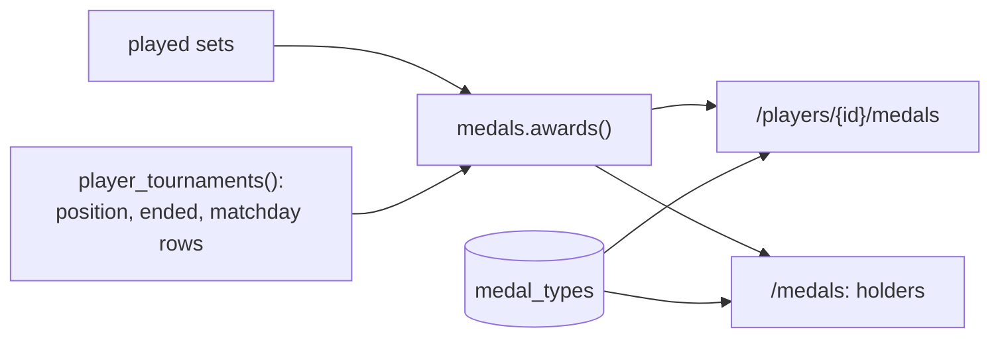

# Medals

Players earn medals by playing. They're computed **live** from the sets every time a page
loads (`app/medals.py`), so they fix themselves when a result is corrected. Nothing about
who has them is stored.

- **Catalog:** the table `medal_types` (`sql/predeployment/0002_medals.sql`): code, kind,
  order, and name and how to win in Spanish and English.
- **Images:** one per medal, `app/static/medals/<code>.svg`, drawn by
  `scripts/make_medals.py` (rerun it after changing a medal).
- **Pages:**
  - `/medals` (🏅 Todas las medallas, linked from Jugadores): the catalog as a table,
    with image, name, how to win it and who holds it.
  - A player's 🏅 Medallas tab (`/players/{id}/medals`): earned medals first, with their
    count, tier or detail; the rest greyed out under "Por ganar".
  - **Ranking tables** (tournament page and home): small medal icons next to each name,
    counting **only that tournament's** sets and matchdays (`tournament_medals()`).
    Tapping them opens the player's medals.

| Kind | Medal | How it's won |
|---|---|---|
| 🥇 Glory | Campeón / Subcampeón / Tercer lugar | 1st / 2nd / 3rd in an **ended** tournament |
| | En llamas | 3 / 5 / 10 sets won in a row (bronze / silver / gold) |
| | Jornada perfecta | All 3 sets of a Liga matchday won |
| | Rey de la pista | 1st on court 1 on a Liga matchday |
| | Escalador | Moved up a court 3 times (Liga, all tournaments together) |
| | Pastelero | A set won 6-0 |
| | El Muro | A set won conceding 1 game or fewer |
| | Corazón de acero | A set won 7-6 |
| | Pareja de oro | 5 wins with the same partner |
| | Siempre presente | Every matchday of an ended tournament played, never absent |
| | Veterano | 25 / 50 / 100 sets played |
| ⚔️ Rivalry | Rival eterno | The opponent faced most (3+ sets) |
| | Verdugo | 3+ sets won against the same opponent |
| 🤡 Shame (a joke) | Gafe | 3 / 5 / 8 sets lost in a row |
| | Comió rosco | A set lost 0-6 |
| | Farolillo rojo | Last in an ended tournament (4+ players) |
| | Jornada negra | All 3 sets of a Liga matchday lost |
| | Paracaídas | Moved down a court 3 times (Liga) |
| | Tiene dueño | The same opponent beat you in 5+ sets |
| | Fantasma | Absent on 2+ matchdays |

Medals about games (Pastelero, El Muro, Corazón de acero, Comió rosco) only count Liga
and Manual sets: in Americano and Mexicano the "games" are points.

**Adding a medal:**
1. Add a row to `medal_types` in a new `sql/predeployment` file.
2. Add its glyph in `scripts/make_medals.py` and run the script.
3. Add the rule in `medals.awards()`.
