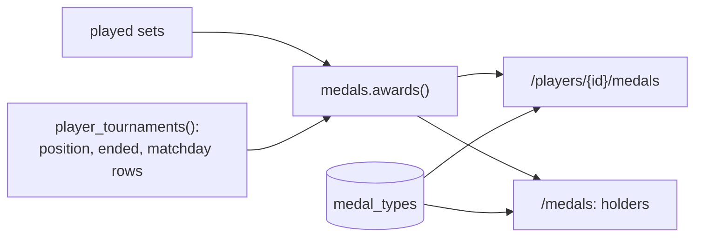

# Medals

Players earn medals by playing. They're computed **live** from the sets every time a page
loads (`app/medals.py`), so they fix themselves when a result is corrected. Nothing about
who has them is stored.

- **Catalog:** the table `medal_types` (`sql/predeployment/0002_medals.sql`, renamed in
  `0003_medals_mexico.sql`): code, kind, order, and name and how to win in Spanish and
  English.
- **Language:** the Spanish names use **Mexican expressions** (zapato for a 6-0, salado,
  sotanero, "es su papá"...), not Spain's (the user's decision, 2026-10-30). The codes
  (`rosco`, `gafe`, `farolillo`...) are the old names and never change.
- **Images:** one per medal, `app/static/medals/<code>.svg`, drawn by
  `scripts/make_medals.py` (rerun it after changing a medal). Each image is **only the
  icon of the situation** (an emoji on a transparent square), with no medal or ribbon
  shape. Tiers show as a bronze, silver or gold glow from the stylesheet.
- **Pages:**
  - `/medals` (🏅 Todas las medallas, linked from Jugadores): the catalog as a table,
    with image, name, how to win it and who holds it.
  - A player's 🏅 Medallas tab (`/players/{id}/medals`): earned medals first, with their
    count, tier or detail; the rest greyed out under "Por ganar".
  - **Ranking tables** (tournament page and home): small medal icons next to each name,
    counting **only that tournament's** sets and matchdays (`tournament_medals()`).
    Tapping them opens the player's medals.

| Kind | Icon | Medal (code) | How it's won |
|---|---|---|---|
| 🥇 Glory | 🥇 🥈 🥉 | Campeón / Subcampeón / Tercer lugar | 1st / 2nd / 3rd in an **ended** tournament |
| | 🔥 | Bien prendido (`racha`) | 3 / 5 / 10 sets won in a row (bronze / silver / gold) |
| | 💯 | Jornada perfecta (`perfecta`) | All 3 sets of a Liga matchday won |
| | 👑 | Rey de la cancha (`rey_pista`) | 1st on court 1 on a Liga matchday |
| | 🧗 | Pa' arriba (`escalador`) | Moved up a court 3 times (Liga, all tournaments together) |
| | 👞 | Zapatero (`rosco`) | A set won 6-0 ("le pusiste zapato") |
| | 🧱 | La Muralla (`muro`) | A set won conceding 1 game or fewer |
| | 💓 | De infarto (`infarto`) | A set won 7-6 |
| | 🤝 | Dupla dorada (`pareja_oro`) | 5 wins with the same partner |
| | 📋 | Asistencia perfecta (`asistencia`) | Every matchday of an ended tournament played, never absent |
| | 🐺 | Colmilludo (`veterano`) | 25 / 50 / 100 sets played |
| ⚔️ Rivalry | ⚔️ | El Clásico (`rival`) | The opponent played against most (3+ sets) |
| | 👨‍👦 | Es su papá (`verdugo`) | 3+ sets won against the same opponent |
| 🤡 Shame (a joke) | 🧂 | Salado (`gafe`) | 3 / 5 / 8 sets lost in a row |
| | 🥾 | Le pusieron zapato (`comio_rosco`) | A set lost 0-6 |
| | 🕳️ | Sotanero (`farolillo`) | Last in an ended tournament (4+ players) |
| | 🌧️ | Jornada pa' olvidar (`jornada_negra`) | All 3 sets of a Liga matchday lost |
| | 📉 | Cuesta abajo (`paracaidas`) | Moved down a court 3 times (Liga) |
| | 🍼 | Ya tiene papá (`bestia_negra`) | The same opponent beat you in 5+ sets |
| | 👻 | Se lo tragó la tierra (`fantasma`) | Absent on 2+ matchdays |

Medals about games (Zapatero, La Muralla, De infarto, Le pusieron zapato) only count
Liga and Manual sets: in Americano and Mexicano the "games" are points.

**Adding a medal:**
1. Add a row to `medal_types` in a new `sql/predeployment` file.
2. Add its glyph in `scripts/make_medals.py` and run the script.
3. Add the rule in `medals.awards()`.
