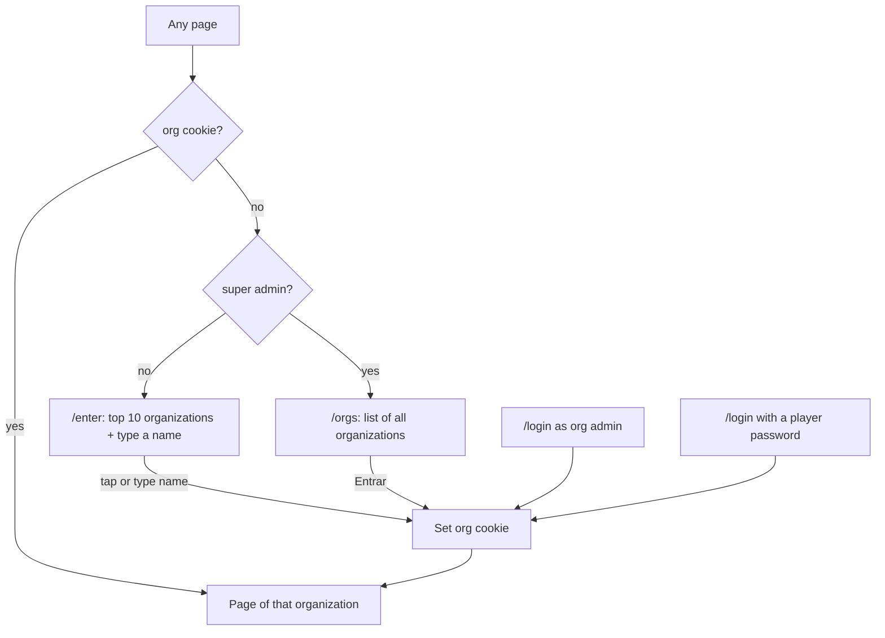
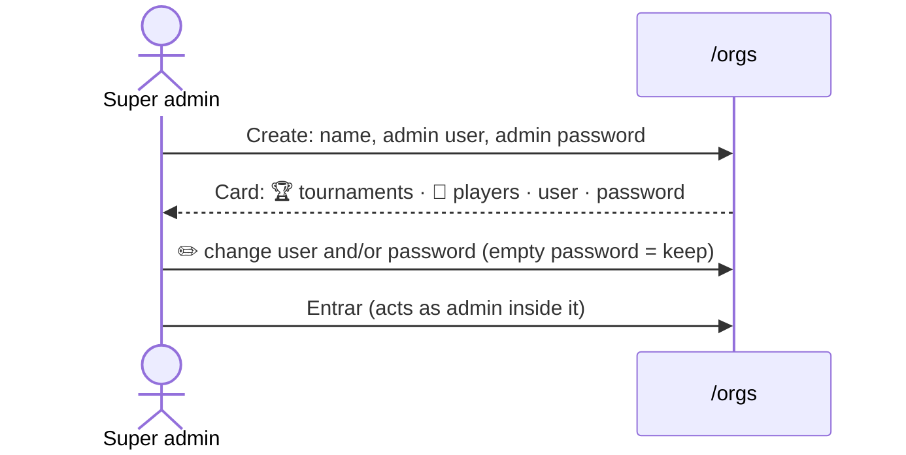

# Organizations

An organization is a club or group of friends. Everything belongs to one: players,
tournaments, and through them jornadas, sets and absences. Nobody sees anything until
they have entered an organization.

- **Fields:** name (unique, case-insensitive) and a random `secret` that signs the
  `org` cookie.
- **Its admin** is an account (a `users` row with role `org_admin` and the organization;
  see [USERS.md](USERS.md)). The username is unique among all accounts. The admin's
  password is a PBKDF2 hash plus a readable copy (`password_plain`) that super admins
  see on `/orgs`. Passwords saved before that copy existed show "unknown" until someone
  changes them. The old `organizations.admin_*` columns are deprecated, but kept in sync
  so the previous app version still works.
- **Player names** are unique per organization, ignoring case, accents and spacing.
  Two organizations may each have a "Julio".
- **Adoption:** the first organization ever created adopts every player and tournament
  that had none, which is how the data from before organizations became Nene's.

## Entering an organization

- `/enter` lists the 10 organizations with the most tournaments (then by name) as
  one-tap buttons. Below the list, any organization's name can be typed.
- The header shows "🏢 name". Tapping it goes back to `/enter` to change organization.
- Pages open without an organization: `/enter`, `/login`, `/logout`, `/static`,
  `/lang`, `/rules`, `/orgs`.
- A middleware, `OrganizationGate` in `app/main.py`, enforces this. Every query
  filters on the current organization (`org_id()`, `ORG_SCOPE`), so one
  organization's admin can't see or change another's data, even by typing ids in the URL.

## Creating and managing organizations (super admin)

From the command line, including the Azure Kudu console: `python -m app.orgs create
"Name" "user" "password"`, `password "user" "new"`, or `superadmin "user" "password"`.
The skill `.claude/skills/padelscore-live-admin` has the steps for the live site.

Organizations can't be deleted from the app.
