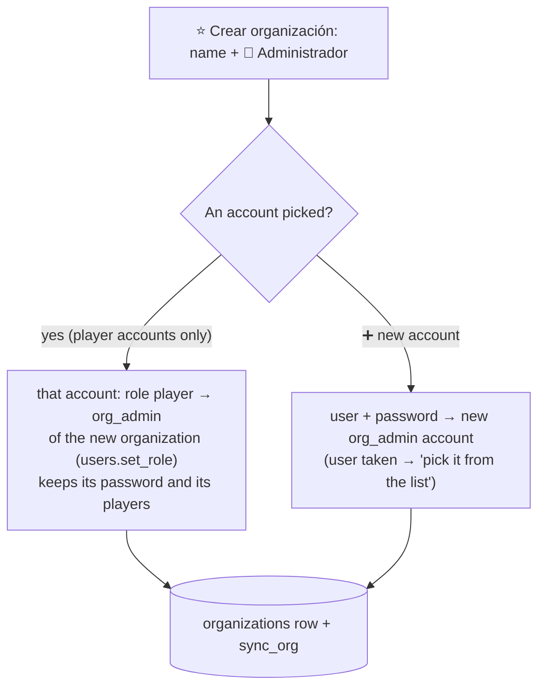
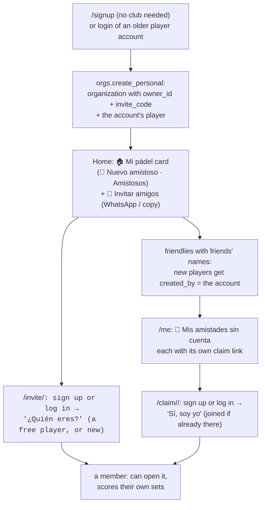
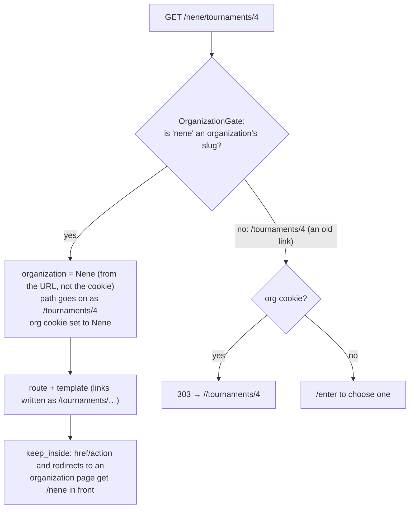
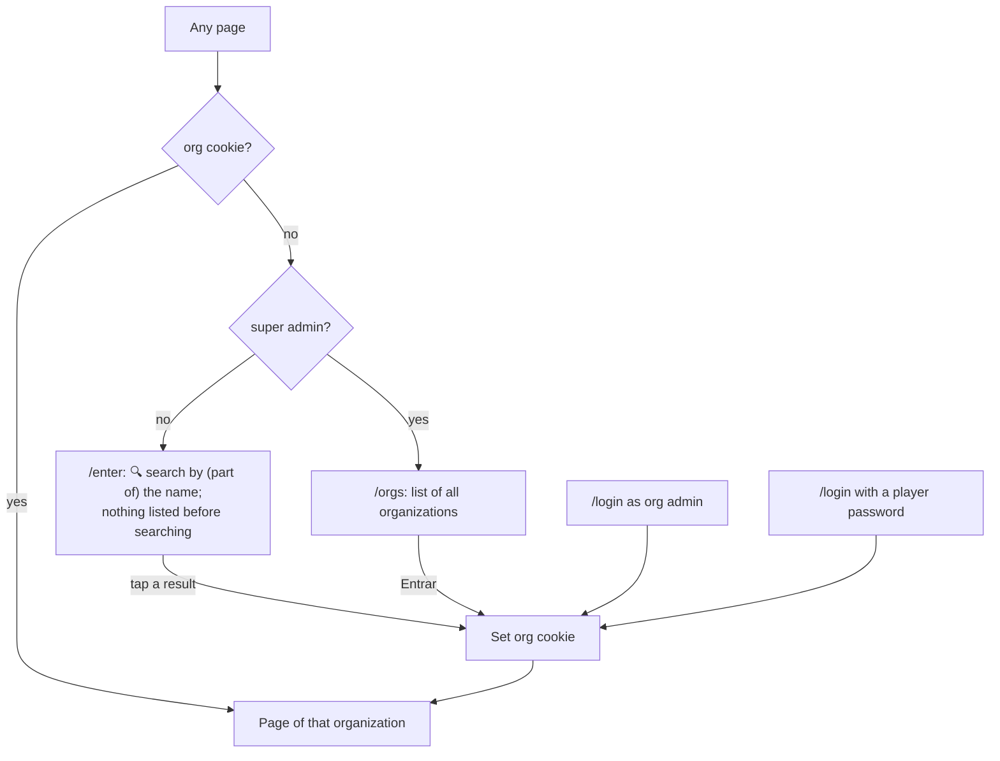
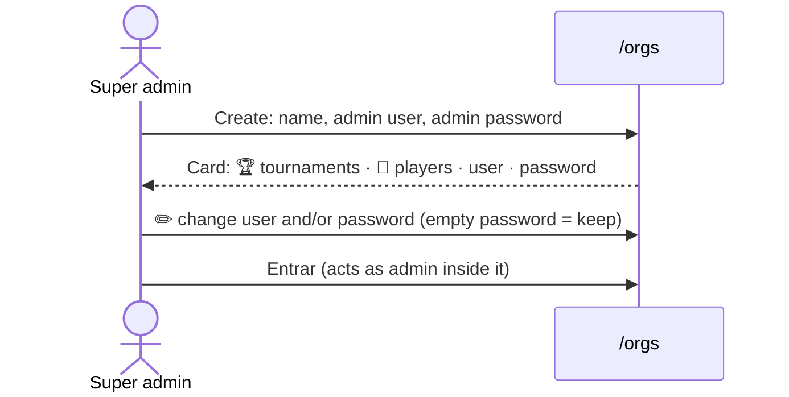

# Organizations

An organization is a club or group of friends. Everything belongs to one: players,
tournaments, and through them jornadas, sets and absences. Nobody sees anything until
they have entered an organization.

- **Fields:** name (unique, case-insensitive) and a random `secret` that signs the
  `org` cookie.
- **Its admin** is an account (a `users` row with role `org_admin` and the organization;
  see [USERS.md](USERS.md)). The username is unique among all accounts. The admin's
  password is a PBKDF2 hash plus a readable copy (`password_plain`) that super admins
  see on `/orgs`. Passwords saved before that copy existed show "unknown" until someone
  changes them. The old `organizations.admin_*` columns are deprecated, but kept in sync
  so the previous app version still works.
- **Player names** are unique per organization, ignoring case, accents and spacing.
  Two organizations may each have a "Julio".
- **Adoption:** the first organization ever created adopts every player and tournament
  that had none, which is how the data from before organizations became Nene's.

## ⭐ Organizaciones (super admins)

`/orgs` is a **table** with a text filter: name, actions (Entrar; ✏️ change its admin's
user or password), its link (`/<slug>`), admin user and password, and its tournaments
and players. 📧 Probar email sends a test to your own address, and "Crear organización"
adds one.

**Creating an organization** (the user asked 2026-11-06): its name, and its admin, from
the **👤 Administrador** list: either an existing **player account** or **➕ Crear una
cuenta nueva** (then its user and password; those fields hide, by CSS `:has()`, once
an account is picked).

- **Only player accounts** are offered: an account has one role and one organization, so
  an organization's admin (or a super admin) can't run a second one. A forced POST with
  one is refused (`err_admin_account`).
- **Passwords:** an account picked from the list keeps its own password, which is only
  a hash, so `/orgs` shows "unknown" for it. A new account's password is readable there,
  as before.
- `orgs.create_org(conn, name, admin_user, password, user_id=None)` does both; the
  Kudu command line (`python -m app.orgs create`) still makes a new account.

## 🏠 Mi pádel (a player's own space)

The user's request, 2026-11-06: a player without a club can still use the app. Every
player account has **Mi pádel**, a private organization it owns (`organizations.owner_id`,
`sql/predeployment/0012_mi_padel.sql`), named "Mi pádel de <username>", with the
account's player in it.

- **Private:** `auth.can_open` lets in only the owner, accounts with a player in it and
  super admins. The gate sends anyone else home (or to log in), and it's not in `/enter`'s
  list nor findable by name there.
- **The owner is its admin** (`auth.is_editor`), but `main.CLUB` keeps the club pages
  out: Cuentas, Emails, Canchas and new tournaments answer 404, and their links are
  hidden. That's on purpose: the owner must not manage their friends' accounts. It has
  just its 🤝 Amistosos (see TOURNAMENTS.md).
- **Members** (friends who joined) score only their own sets, as in a club.
- **Invitation:** `/invite/<invite_code>` (an open path). A logged-in account picks
  who it is among the unclaimed players, or joins as new; then it enters the space.
- **Friends without an account:** a friendly that creates a player saves who wrote it
  (`players.created_by`). Until someone claims it, it's listed in the writer's profile
  with a **claim link** `/claim/<player>/<token>` (signed with the organization's
  secret, `auth.claim_token`). Claiming links the player to the account
  (`users.link_player(..., merge=True)`: an existing player there is joined).
- **Older accounts** get their Mi pádel when they next log in. Converting a Mi pádel
  into a club (the paid plan) is for later.

## Each organization's URLs (`/<slug>/...`)

Every organization has a **slug**, its name in its URLs (`Nene` → `nene`). Its pages
live under it, so a link shows that organization only and the browsing stays inside it
(the user's request, 2026-11-05):

| URL | Page |
|---|---|
| `/nene` | its standings (same as `/nene/standings`) |
| `/nene/tournaments`, `/nene/tournaments/4`, `/nene/tournaments/4/summary` | tournaments |
| `/nene/matchdays/19`, `/nene/matches`, `/nene/matches/12/edit` | jornadas and sets |
| `/nene/players`, `/nene/players/2`, `/nene/players/2/vs`, `/nene/medals` | players, stats, medals |
| `/nene/users`, `/nene/courts` | admin pages |

- **The slug** is `orgs.slugify(name)`: lowercase ASCII, accents removed, dashes between
  words, `-2`, `-3`… if taken. Names that match one of the app's paths (`players`,
  `login`…, `orgs.RESERVED`) get `-org`. Existing organizations got theirs from
  `sql/predeployment/0007_org_slugs.sql`. ⭐ Organizaciones shows each one's link.
- **Templates and routes don't change:** they keep writing `/tournaments/4`. The gate
  (`main.OrganizationGate`) strips the prefix on the way in and adds it on the way out
  (links in the HTML and `Location` headers, for the paths in `orgs.SECTIONS`).
- **What stays outside a slug:** the home page `/` (an account's tournaments in every
  organization, as before), `/me`, `/login`, `/enter`, `/orgs`, `/install`, `/rules`,
  `/welcome`, `/signup`, `/r/…` and `/unsubscribe/…`. Their links to an organization's
  pages pass through `/enter` or are redirected into `/<slug>/…`.
- **Emails** link to `/<slug>/matchdays/<id>`.

## Entering an organization

- `/enter` lists **no organization until you search** (the user's request, 2026-11-10:
  a visitor sees no organization they didn't look for). `?q=` (2 letters at least)
  shows the clubs whose name contains it, ignoring case and accents
  (`main.search_orgs`); a 🏠 Mi pádel is never found.
- The header shows "🏢 name". Tapping it goes back to `/enter` to change organization.
- Pages open without an organization: `/enter`, `/login`, `/logout`, `/static`,
  `/lang`, `/rules`, `/orgs`.
- A middleware, `OrganizationGate` in `app/main.py`, enforces this. Every query
  filters on the current organization (`org_id()`, `ORG_SCOPE`), so one
  organization's admin can't see or change another's data, even by typing ids in the URL.

## Creating and managing organizations (super admin)

From the command line, including the Azure Kudu console: `python -m app.orgs create
"Name" "user" "password"`, `password "user" "new"`, or `superadmin "user" "password"`.
The skill `.claude/skills/padelscore-live-admin` has the steps for the live site.

Organizations can't be deleted from the app.
