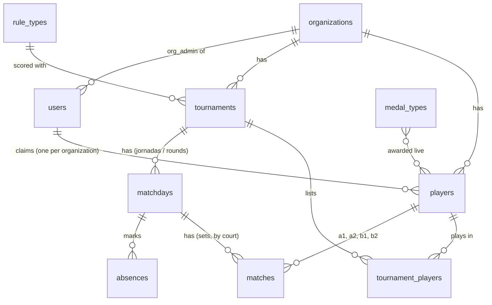
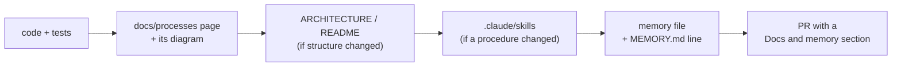

# PadelScore processes

How the app works, one page per area, each with a diagram (Mermaid: GitHub draws them).

| Page | What it covers |
|---|---|
| [Organizations](ORGANIZATIONS.md) | Entering an organization, creating one, its admin, data isolation |
| [Users and logins](USERS.md) | Super admin, organization admin, players; what each may do |
| [Tournaments](TOURNAMENTS.md) | Creating, rule types, players, replacing, ending, deleting |
| [Jornadas](JORNADAS.md) | Matchdays and rounds: courts, sets, absences, court changes |
| [Sets](SETS.md) | Entering and editing results, scoring per rule type |
| [Player statistics](STATS.md) | The dashboard: tiles, charts, partners and rivals |
| [Medals](MEDALS.md) | Medals players earn (glory, rivalry, shame), their images and rules |
| [Architecture](ARCHITECTURE.md) | Modules, a request's path, the data model, where things run |
| [Deploy](DEPLOY.md) | Pull request → tests → automatic deploy to Azure |

The data model behind all of them:

## Keeping these pages current

Every pull request documents itself (the rule is in `CLAUDE.md`, and the checklist is in
`.github/pull_request_template.md`). The docs travel in the same branch as the code, so
`main` never has a feature without its page.

Rule types: 1 `liga_amigos` (Liga de amigos score), 2 `americano`, 3 `mexicano`,
4 `manual` (Manual individual). The full league rules are in [REGLAMENTO.md](../REGLAMENTO.md).
