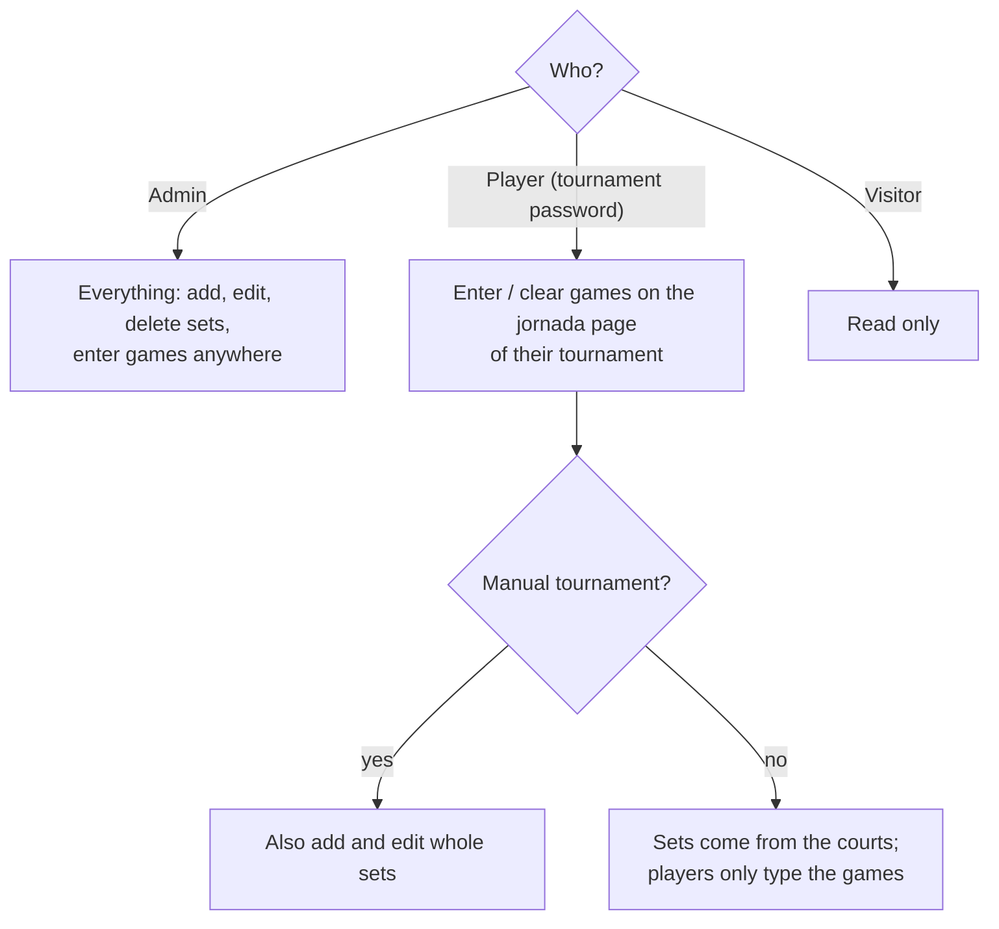
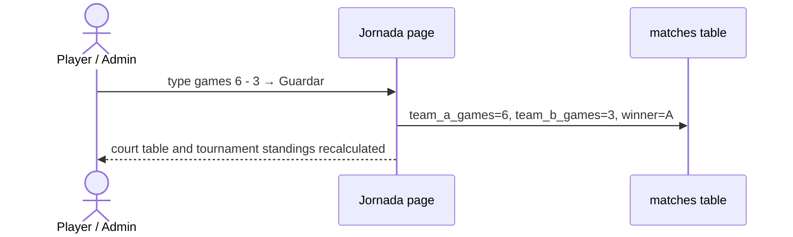

# Sets

A set belongs to a jornada and a court. It has two pairs, A (a1 + a2) and B (b1 + b2),
the games of each team and the winner. A set with no games yet is **pending** and
scores nothing.

## Who enters what

- **On the jornada page**, each set has the boxes for both teams' games. Both must be
  filled, or both emptied to make the set pending again. A tie is allowed (no winner).
- **The set form** (`/matches/new`, `/matches/{id}/edit`) checks:
  - 4 different players, all from this organization;
  - a jornada of this organization;
  - a court of 1 or more;
  - both games, or neither.
- **Deleting a set** is for admins only.
- **The Sets tab** (`/matches`) lists every set and can be filtered by tournament,
  jornada and player.

## Points per set, by rule type

| Rule type | Each player of the pair gets |
|---|---|
| Liga de amigos | Nothing per set by itself. When the court's 3 sets are played: place points 9 / 6 / 4 / 3 + 1 per set won |
| Americano / Mexicano | The games (points) their pair won |
| Manual individual | The games difference: 6-3 gives +3 to the winners and −3 to the losers; totals can be negative |

An absent player scores 0 for that jornada, whatever their substitute did.

Standings are always calculated from the sets; no totals are stored.
