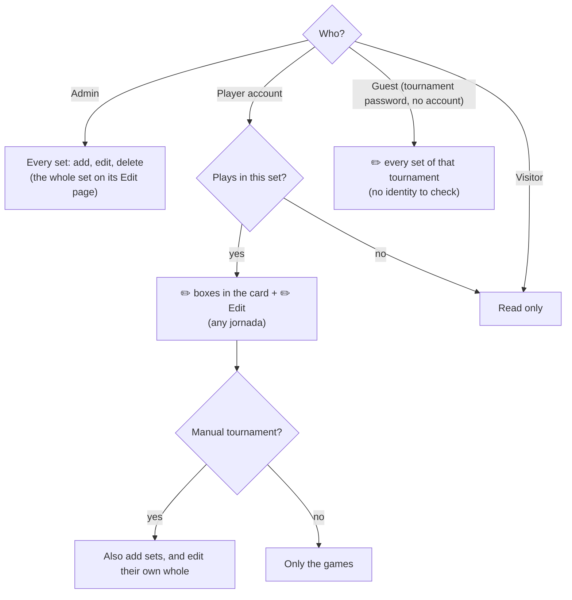
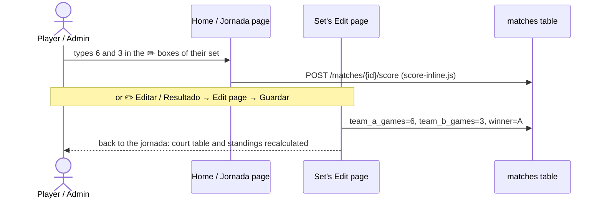

# Sets

A set belongs to a jornada and a court. It has two pairs, A (a1 + a2) and B (b1 + b2),
the games of each team and the winner. A set with no games yet is **pending** and
scores nothing.

## Who enters what

- **Who may score a set** (`auth.can_score_set`, the user's decision 2026-11-06): the
  admin, every set; a player account, only the sets it plays in (its player is one of
  the four), in any jornada; a guest who logged in with the tournament's password, every
  set of that tournament (a guest has no identity). `/matches/{id}/edit`, `/score`,
  `/sets` and the Manual set form all check it; adding sets in Manual tournaments and
  the Retas / Rey round buttons stay per tournament.
- **Editable score boxes:** on the jornada page the cards of the sets this visitor may
  score have their two boxes as inputs (`_match_row.html`, `scorable` from
  `matchday_page`): white with a dashed blue border and a ✏️ badge, so they read as
  editable; the others stay gray. `static/score-inline.js` posts to
  `/matches/{id}/score` once both boxes have games (or both are emptied) and the page
  comes back at the card. Escalafón matches (3 sets) keep only ✏️ Edit.
- **The Edit page** (`/matches/{id}/edit`) is still there for every set one may score.
  Admins, and players of Manual tournaments, get the whole set form. Other players get
  a page with just the two games boxes (`match_score.html`, same editable look), which
  posts to `/matches/{id}/score` and returns to the jornada. Both games are required.
  A tie is allowed (no winner).
- **Players find their sets** on the home page (`/`): "⏳ Mis próximos sets" lists the
  pending sets of every tournament they play, oldest date first. For an account, each
  has the same editable ✏️ boxes (the user asked, 2026-11-06): the form posts to the
  set's own organization (`/<slug>/matches/{id}/score`, `back=home`) and the page comes
  back to the home page. Escalafón matches and guests keep only ✏️ Resultado.
- **The set form** (`/matches/new`, `/matches/{id}/edit`) checks:
  - 4 different players, all from this organization;
  - a jornada of this organization;
  - a court of 1 or more;
  - both games, or neither.
- **Deleting a set** is for admins only.
- **The Sets tab** (`/matches`) lists every set and can be filtered by tournament,
  jornada and player.

## Points per set, by rule type

| Rule type | Each player of the pair gets |
|---|---|
| Liga de amigos | Nothing per set by itself. When the court's 3 sets are played: place points 9 / 6 / 4 / 3 + 1 per set won |
| Americano / Mexicano | The games (points) their pair won |
| Manual individual | The games difference: 6-3 gives +3 to the winners and −3 to the losers; totals can be negative |
| 🤝 Amistosos | 1 per set won (0 for a loss or a tie); friendlies are recorded on `/friendlies/new` (TOURNAMENTS.md) |

An absent player scores 0 for that jornada, whatever their substitute did.

Standings are always calculated from the sets; no totals are stored.
