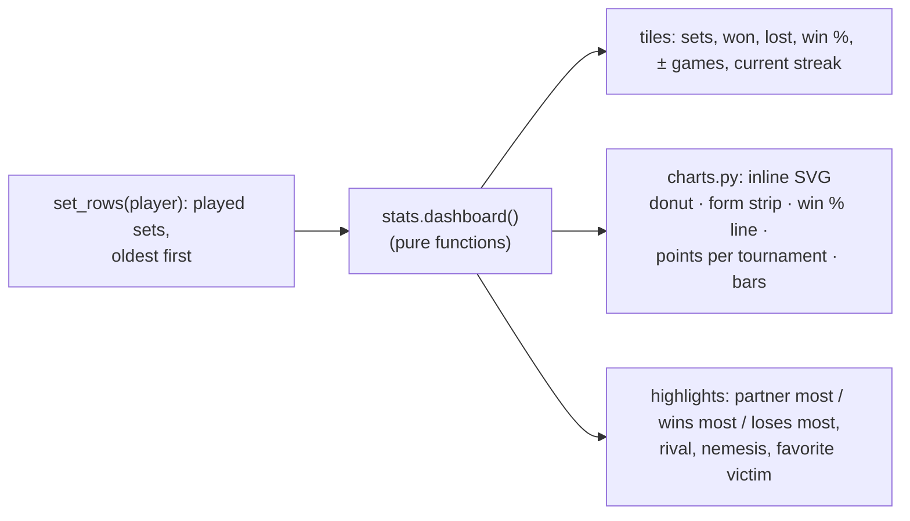

# Player statistics

Every player page has two tabs: **📋 Resumen** (`/players/{id}`: tournaments, partners,
sets) and **📊 Estadísticas** (`/players/{id}/stats`). Anyone in the organization can see
them, like the standings. Accounts reach their own from `/me`.

| Shown | How it's computed (`app/stats.py`) |
|---|---|
| Sets, won, lost, tied, win % | Played sets only. A set with no winner is tied |
| ± games | Games for minus games against (points in Americano and Mexicano) |
| Current / best / worst streak | Runs of consecutive results, oldest first |
| Form | The last 30 results as green, red and grey squares |
| Win % (last 10 sets) | After each set, the wins among the last 10 |
| Points over time | Per tournament, the cumulative points of each matchday (from the standings) |
| Most frequent partner | The most sets together |
| Wins most / loses most with | The most wins or losses together, among partners with at least 3 sets |
| Rival | The opponent faced most |
| Nemesis / favorite victim | The opponent who beat you most / you beat most |
| Sets per month | The last 12 months with sets |

The charts are plain SVG built on the server (`app/charts.py`), with no JavaScript. They
use the stylesheet's colors, so they work in dark mode. Tapping a point or bar shows its
value. Labels are escaped.
