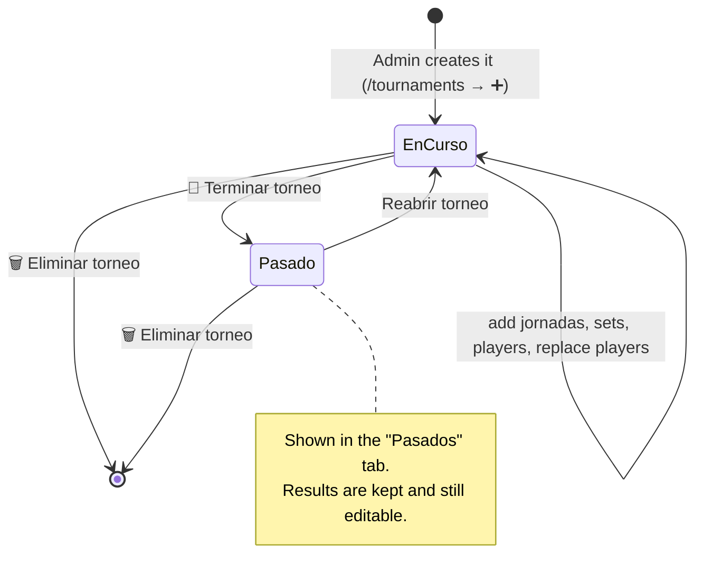

# Tournaments

A tournament belongs to an organization. It has a name, a date, a rule type, a player
password, a list of players and its jornadas. Only admins change tournaments: the
organization admin, or a super admin who entered the organization.

## Creating one

You give it a name, a date (`held_on`), a rule type and its players: existing ones,
plus new names typed in, which become players. Optionally you also give a player
password and, for Americano and Mexicano, the points per match.

| Rule type | How it's played | Needs |
|---|---|---|
| Liga de amigos score | Jornadas; courts of 4 play 3 sets each, places 9/6/4/3 + 1 per set won | — |
| Americano | Rounds; partners rotate so everyone partners everyone | ≥ 4 players |
| Mexicano | Rounds; round 1 drawn, then the ranking makes the courts | ≥ 4 players |
| Manual individual | Jornadas with only a date; sets added by hand; points = games difference | — |

## Players of a tournament

These actions are on the tournament page, in the players section:

- **Add**: pick a player, or type a new name and create it.
- **Remove**: takes the player out of the list. Their sets and points so far stay.
- **Replace**: the new player takes the old one's place in the list and in the
  *pending* (not yet played) sets only. Played sets stay with the old player. It can
  also be started from the jornada page, with the "Reemplazar" link next to a player
  in a court table.

## Ending (Terminar torneo)

- **Who:** only an admin. Visitors and players don't see the button.
- **Where:** the button **🏁 Terminar torneo** is at the bottom of the tournament page,
  above **Eliminar torneo**.
- **Conditions:** none. Any tournament can be ended at any time, even with pending sets.
- **Effect:** it moves from the "En curso" tab to "Pasados", and from the home tabs
  to the past list. Nothing is locked: results stay and can still be edited. **Reabrir
  torneo** brings it back.

## Deleting

**Eliminar torneo** asks for confirmation, then deletes the tournament with all its
jornadas, sets and absences. Players are kept.
