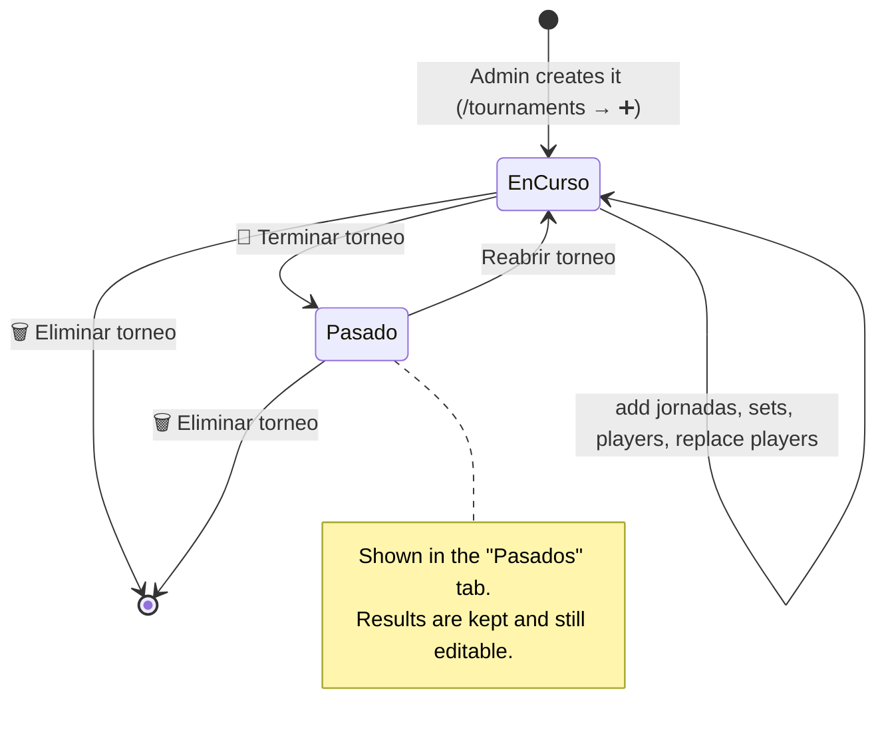
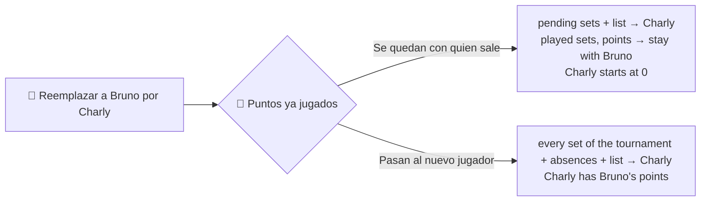
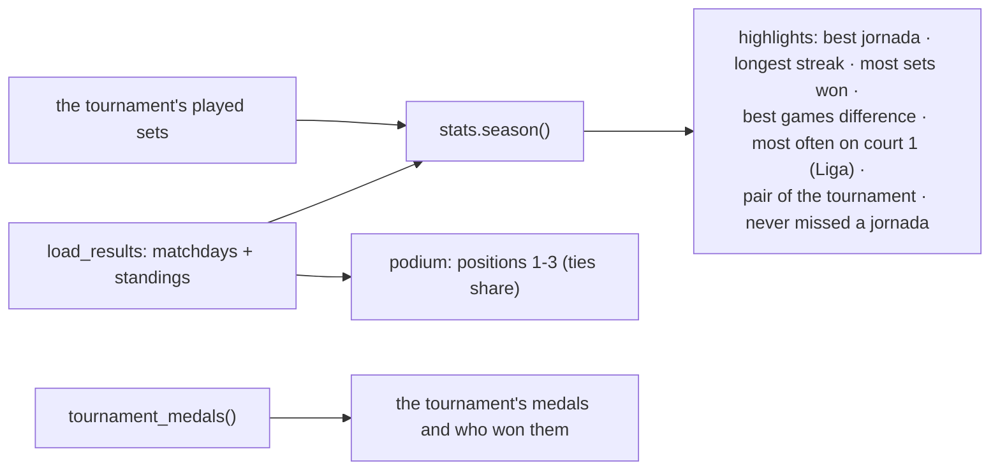

# Tournaments

A tournament belongs to an organization. It has a name, a date, a rule type, a player
password, a list of players and its jornadas. Only admins change tournaments: the
organization admin, or a super admin who entered the organization.

## Creating one

You give it a name, a date (`held_on`), a rule type and its players: existing ones,
plus new names typed in, which become players. Optionally you also give a player
password and, for Americano and Mexicano, the points per match.

| Rule type | How it's played | Needs |
|---|---|---|
| Liga de amigos score | Jornadas; courts of 4 play 3 sets each, places 9/6/4/3 + 1 per set won | — |
| Americano | Rounds; partners rotate so everyone partners everyone | ≥ 4 players |
| Mexicano | Rounds; round 1 drawn, then the ranking makes the courts | ≥ 4 players |
| Manual individual | Jornadas with only a date; sets added by hand; points = games difference | — |

## Players of a tournament

These actions are on the tournament page, in the players section:

- **Add**: pick a player, or type a new name and create it.
- **Remove**: takes the player out of the list. Their sets and points so far stay.
  Someone who played the last jornada is still suggested for the next one; saving it
  puts them back on the list. To take them out for good, change their court in the
  new jornada before saving.
- **Replace**: the new player takes the old one's place in the list and in the
  *pending* (not yet played) sets. **🎯 Puntos ya jugados** chooses what happens to
  the sets already played in this tournament (the user's request, 2026-11-05):
  - **Se quedan con quien sale** (the default): played sets and their points stay with
    the old player, and the new one starts from zero.
  - **Pasan al nuevo jugador**: the played sets and the absences move too, so the new
    player takes the whole place: points, per-jornada history and medals of this
    tournament. It's refused if the new player already played with or against the
    old one in this tournament (a set can't have the same player twice).

  It can also be started from the jornada page, with the "Reemplazar" link next to a
  player in a court table.

## 🏁 Summary (Resumen del torneo)

`/tournaments/{id}/summary`, linked as "🏁 Resumen" under the tournament's name once it
has a jornada. It says "Resultado final" when the tournament has ended and "Hasta
ahora" while it's going, and shows:

A highlight only shows when someone stands out (e.g. a streak of 2+ wins, a pair with 2+
wins together). Everything is calculated from the sets, like the standings.

## Ending (Terminar torneo)

- **Who:** only an admin. Visitors and players don't see the button.
- **Where:** the button **🏁 Terminar torneo** is at the bottom of the tournament page,
  above **Eliminar torneo**.
- **Conditions:** none. Any tournament can be ended at any time, even with pending sets.
- **Effect:** it moves from the "En curso" tab to "Pasados", and from the home tabs
  to the past list. Nothing is locked: results stay and can still be edited. **Reabrir
  torneo** brings it back.

## Deleting

**Eliminar torneo** asks for confirmation, then deletes the tournament with all its
jornadas, sets and absences. Players are kept.
