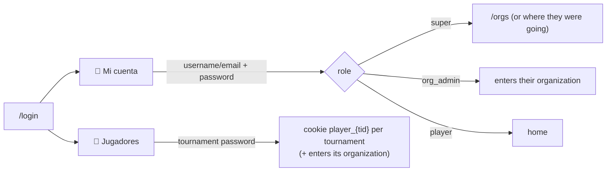
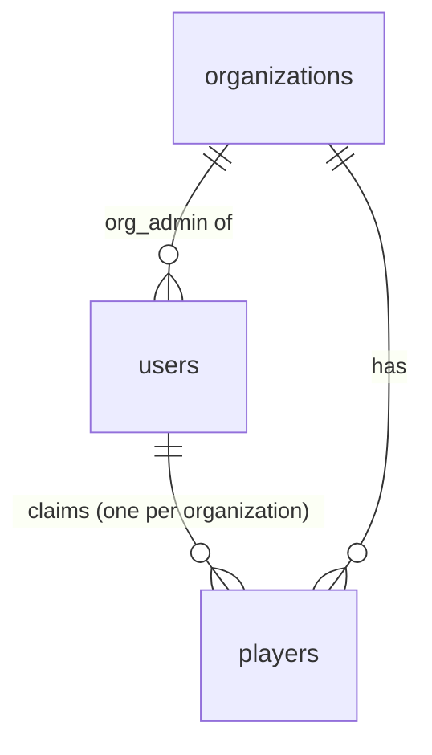
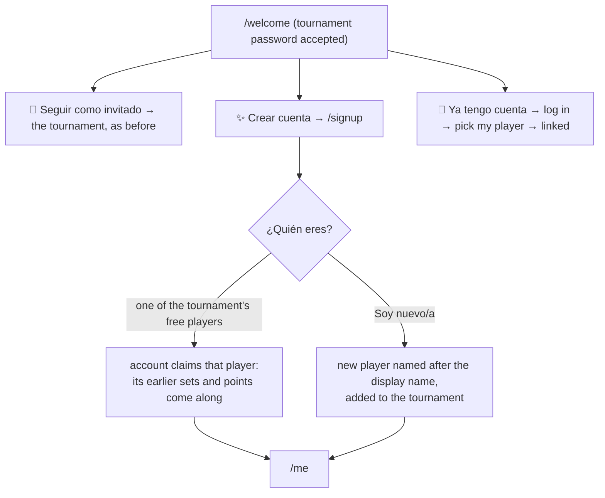

# Users and logins

Everyone who logs in has an **account** (table `users`, code in `app/users.py`), with a
unique username, an optional email (required for players), names and a role. An account
logs in with its **username or email** and password. Players can also come in as
**guests** with a tournament's player password.

| Who | Logs in with | May do |
|---|---|---|
| **Visitor** (not logged in) | nothing; just enters an organization | See standings, tournaments, jornadas, sets, players |
| **👻 Guest player** | a tournament's *player password* | Enter games of sets in that tournament from the jornada page. In Manual tournaments, also add and edit sets |
| **🎾 Player account** | username or email + password | The same, in every tournament its linked player plays in |
| **🏢 Organization admin** | username or email + password | Everything inside their organization (an *editor*), including its accounts |
| **⭐ Super admin** | username or email + password | Create organizations, see and change admin credentials, change roles, act as admin in any organization |

## Accounts and players

A player row without `user_id` is a **guest player**: just a name. An account can claim
one player per organization (`players.user_id`). Its sets and tournaments are then that
account's. Admins link and unlink players on **🔑 Cuentas** (`/users`).

## From guest to account

After a tournament's player password, a browser without an account lands on
`/welcome`:

- **Who can claim:** only a browser that has the tournament's password can claim one of
  its players, and only players nobody has claimed yet.
- **Signup asks for:** first and last name, display name, username, email, and a
  password of at least 8 characters, entered twice.
- **The display name is the league name:** it renames the claimed player, unless
  another player of that organization already has that name.
- **A player account** scores in its tournaments without the tournament password.

## Profile (`/me`)

Any account can open `/me`, from the 👤 name in the header. It shows:

- for each of its players, by organization: the tournaments with position and points,
  the sets still to play (with a link to the jornada to score them), and the latest
  sets;
- a form to edit names, display name, username and email;
- a form to change the password, which asks for the current one.

## Details

- **Admins manage accounts** on `/users`:
  - Organization admins see their organization's admins and the accounts of its
    players. They change details and passwords, and link or unlink players.
  - Super admins see every account and can also change roles.
- **Passwords** are PBKDF2 hashes. Organization admins' passwords are also kept
  readable (`password_plain`) so super admins can look them up on `/orgs`. Players'
  passwords never are.
- **Cookies** are signed with HMAC:
  - `org`: which organization this browser is in.
  - `user`: the account. Includes the password hash, so a new password logs that
    account out everywhere.
  - `player_{tid}`: a guest of tournament `tid`.
- **Wrong passwords** wait 1 second before answering. **Log out** clears the account
  and guest cookies; the organization is kept.
- **Player password** of a tournament: the default is its name in lowercase with
  underscores. Admins see and change it on the tournament page.
- Accounts came from the old `superadmins` table and `organizations.admin_*` columns
  through `sql/predeployment/0001_users.sql`. The old columns are kept in sync, so the
  previous app version keeps working.
