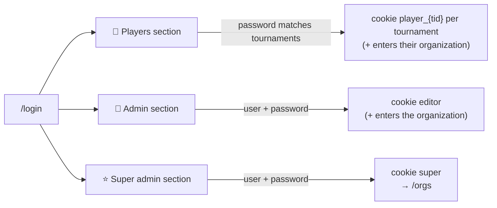

# Users and logins

There are no personal accounts, only three kinds of login. Each has its own section on
`/login`, and each section only accepts its own kind: a super admin's credentials typed
in the admin section fail.

| Who | Logs in with | May do |
|---|---|---|
| **Visitor** (not logged in) | nothing; just enters an organization | See standings, tournaments, jornadas, sets, players |
| **🎾 Player** | a tournament's *player password* | Enter games of sets in that tournament from the jornada page. In Manual tournaments, also add and edit sets |
| **🏢 Organization admin** | the organization's admin user + password | Everything inside that organization (an *editor*) |
| **⭐ Super admin** | super admin user + password | Create organizations, see and change their admin credentials, enter any organization as its admin |

## Details

- **Player password.** Every tournament has one. The default is the tournament name in
  lowercase with underscores ("Liga de la Amistad" → `liga_de_la_amistad`). Admins
  see and change it on the tournament page, to share it with the players. One password
  may log in to several tournaments at once if they share it.
- **Cookies.** All are signed with HMAC using the organization's or super admin's
  `secret`:
  - `org`: which organization this browser is in.
  - `editor`: the admin. Includes the password hash, so changing the admin password
    logs every admin out.
  - `super`: the super admin.
  - `player_{tid}`: a player of tournament `tid`.
- **Wrong passwords** wait 1 second before answering, to slow down guessing.
- **Log out** (`/logout`) clears the editor, super admin and player cookies. The
  organization is kept.
- Code: `app/auth.py` has the checks and cookies. `app/orgs.py` has the password
  hashing and the CLI.
