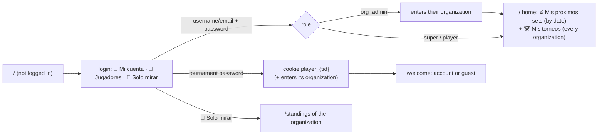
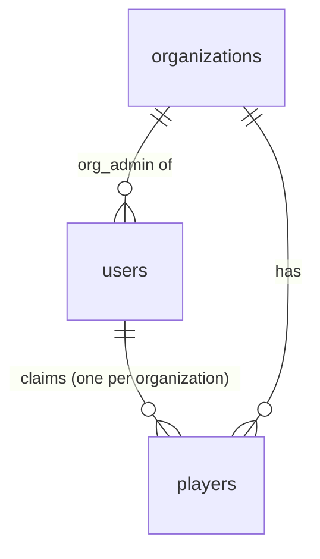
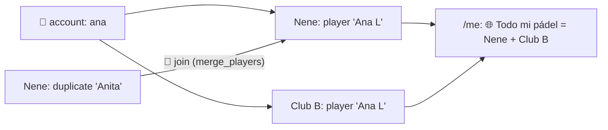
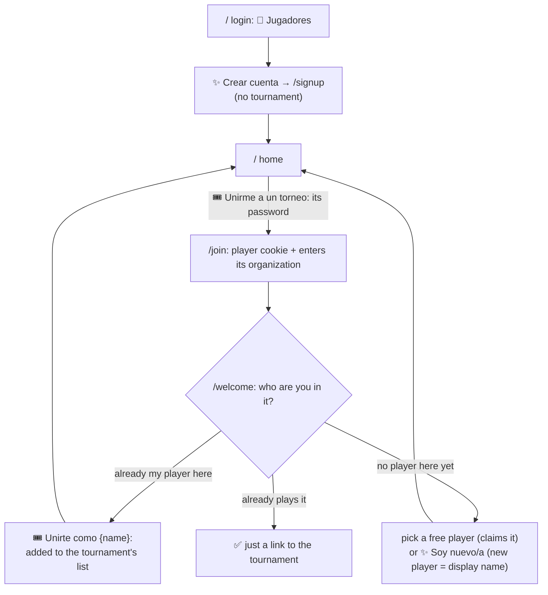
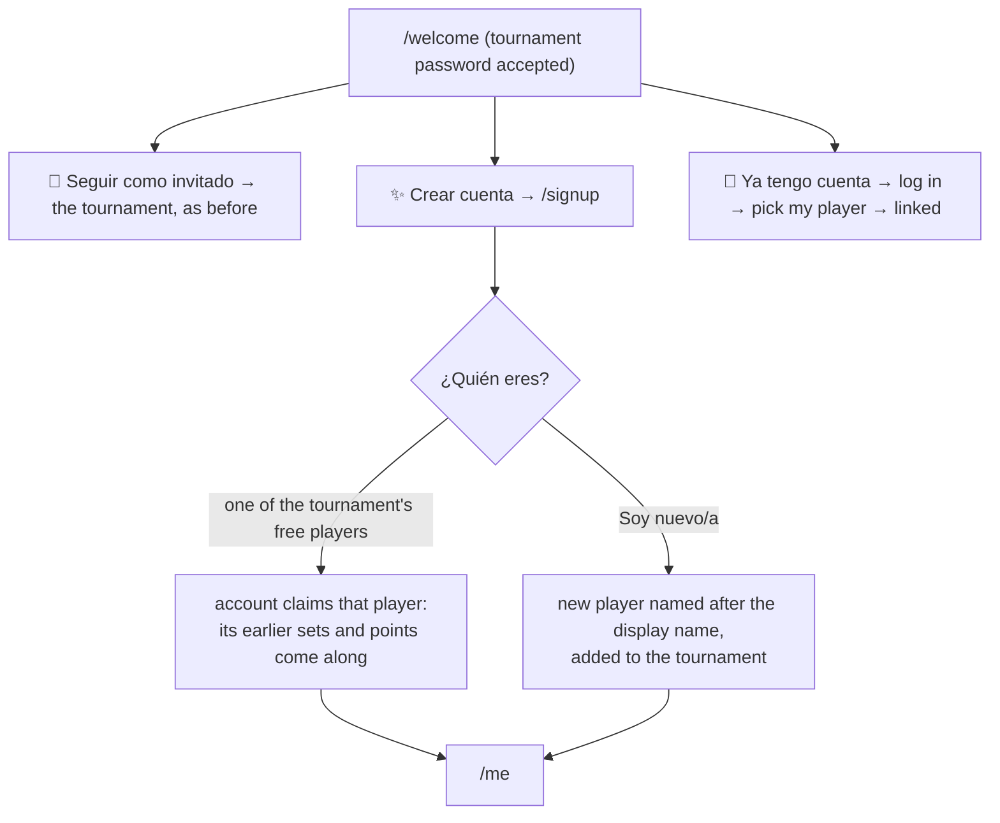

# Users and logins

Everyone who logs in has an **account** (table `users`, code in `app/users.py`), with a
unique username, an optional email (required for players), names and a role. An account
logs in with its **username or email** and password. Players can also come in as
**guests** with a tournament's player password.

| Who | Logs in with | May do |
|---|---|---|
| **Visitor** (not logged in) | nothing; just enters an organization | See standings, tournaments, jornadas, sets, players |
| **👻 Guest player** | a tournament's *player password* | Enter games of sets in that tournament from the jornada page. In Manual tournaments, also add and edit sets |
| **🎾 Player account** | username or email + password | The same, in every tournament its linked player plays in |
| **🏢 Organization admin** | username or email + password | Everything inside their organization (an *editor*), including its accounts |
| **⭐ Super admin** | username or email + password | Create organizations, see and change admin credentials, change roles, act as admin in any organization |

## The home page (`/`)

- **Nobody logged in:** `/` is the login, with a third section, 👀 **Solo mirar**,
  that goes to the organization's standings (`/standings`) or to choosing one.
- **Logged in:** `/` lists:
  - **⏳ Mis próximos sets:** the pending sets of the account's players, in every
    organization, oldest date first. Each has a link to enter its result (the set's
    Edit page, see [SETS.md](SETS.md)).
  - **🏆 Mis torneos:** every tournament the account plays (🎾, with position and points)
    or runs (🛠️ Admin: all of their organization's for an org admin, every
    organization's for a super admin). Tournaments still going come first.
  - A **guest** sees the tournaments whose password the browser has, with all their
    pending sets.
- Links into another organization go through `/enter`, which switches the browser to
  that organization first. The code is `home`, `account_home` and `guest_home` in
  `app/main.py`.

## Accounts and players

**Players belong to an organization; accounts belong to the whole app.** A player row
is a name inside one organization (its sets, tournaments and standings live there). An
account is the person, and it unifies their players:

- A player row without `user_id` is a **guest player**: just a name.
- An account claims **one player per organization** (`players.user_id`). Claiming
  applies everywhere that player appears: every set, tournament, ranking, stat and
  medal of it is the account's.
- Someone who plays in two organizations has two players (one in each) and one account.
  `/me` adds them up under **🌐 Todo mi pádel** (sets, wins, win rate, tournaments,
  organizations, medals) and lists each organization below.
- **Duplicates in one organization are joined, not linked.** If the person was entered
  twice (another name for the same person), the account's player absorbs the duplicate:
  its sets, tournament lists and absences move over, and the duplicate is deleted
  (`users.merge_players`). It's refused if the two played in the same set, because then
  they're two people. The player can do it on `/welcome` (🧩 ¿También eres tú?) with a
  tournament's password, and admins can do it on the account's page in 🔑 Cuentas.
- The display name is the league name: it renames the account's players in every
  organization (when the name is free there). **Rankings show "Display name
  (username)"** for players with an account. Guests show just their name.

## Account first: joining tournaments with their password

Players are asked to **make an account first** (the user's decision, 2026-10-30). The
login's 🎾 Jugadores section says "¿No tienes cuenta? Créala" and links to `/signup`,
which then asks for no tournament. Once inside, the home page has **🎟️ Unirme a un
torneo**: the tournament's player password works as its invitation (`POST /join`).

- A wrong password waits 1 second and shows the error on the home page's card.
- **Guests still work:** under 🎾 Jugadores, "👻 Solo anotar resultados, sin cuenta"
  folds out the old tournament-password form. That's for someone who only enters a
  result.

## From guest to account

After a tournament's player password, a browser without an account lands on
`/welcome`:

An account that is already logged in gets the account-first `/welcome` instead (see
above). A guest's tournament password still offers the three choices.

- **Who can claim:** only a browser that has the tournament's password can claim one of
  its players, and only players nobody has claimed yet.
- **Signup asks for:** first and last name, display name, username, email, and a
  password of at least 8 characters, entered twice.
- **The display name is the league name:** it renames the claimed player, unless
  another player of that organization already has that name.
- **A player account** scores in its tournaments without the tournament password.

## Profile (`/me`)

Any account can open `/me`, from the 👤 name in the header. It shows:

- for each of its players, by organization: the tournaments with position and points,
  the sets still to play (with a link to the jornada to score them), and the latest
  sets;
- a form to edit names, display name, username and email;
- a form to change the password, which asks for the current one.

## Details

- **Admins manage accounts** on `/users`:
  - Organization admins see their organization's admins and the accounts of its
    players. They change details and passwords, and link or unlink players.
  - Super admins see every account and can also change roles.
- **Passwords** are PBKDF2 hashes. Organization admins' passwords are also kept
  readable (`password_plain`) so super admins can look them up on `/orgs`. Players'
  passwords never are.
- **Cookies** are signed with HMAC:
  - `org`: which organization this browser is in.
  - `user`: the account. Includes the password hash, so a new password logs that
    account out everywhere.
  - `player_{tid}`: a guest of tournament `tid`.
- **Wrong passwords** wait 1 second before answering. **Log out** clears the account
  and guest cookies; the organization is kept.
- **Player password** of a tournament: the default is its name in lowercase with
  underscores. Admins see and change it on the tournament page.
- Accounts came from the old `superadmins` table and `organizations.admin_*` columns
  through `sql/predeployment/0001_users.sql`. The old columns are kept in sync, so the
  previous app version keeps working.
